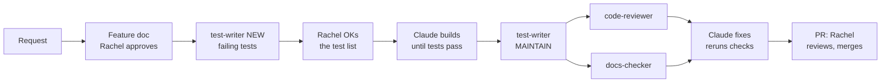

# CLAUDE.md — Preppers

Read this first in every session on this repo.

## Roles

- **Claude Code builds Preppers.** It writes the app code, tests and `e2e` scenarios from the approved feature doc, one small step at a time.
- **Rachel decides and reviews.** She sets the scope, approves each feature doc and test list, reviews every PR, approves doc changes, and merges.
- The goal is test-driven, reliable, focused, high-quality code and docs from Claude Code. When a way of working isn't giving that, say so and suggest a better one.
- Rachel is learning backend and SQL. In PR summaries, explain backend choices in plain terms, and show the SQL a Drizzle query produces when it helps.
- Docs are for Rachel to review and for Claude to build from: plain steps, file names, routes, tables, rules, official links. Short shapes only (a route, a type, a SQL clause), no full implementations.

## Files for Claude vs people

- `CLAUDE.md` files are for Claude. There is one here and one in each of `web`, `api` and `e2e` with rules for that folder. Read the root one, then the one for the folder you're working in.
- `README.md` files are for people. Keep them plain, friendly and free of Claude instructions.

## Source of truth

1. [Notion Preppers page](https://app.notion.com/p/rachelwong/Preppers-3e3375d34b348008ac5dc6f1bc3dc7c0) — ideas, features, scope.
2. `docs/plan/` — build plan (mirrors the Claude doc "Preppers — Staged Build Plan").
3. `docs/adr/` — decisions. `docs/data-model/entities/` — tables. `docs/features/` — per-stage instructions.

If code and docs disagree, raise it; don't silently pick one.

## How every change is built

Use this for **every** request that changes code: starting a stage or step, building a feature, making an adjustment, or fixing a bug. Only skip it for changes with no code, such as docs only, and say so when skipping.

1. **Doc first.** Write or update the feature doc. A bug fix or adjustment updates the doc of the stage it belongs to. Rachel approves it.
2. **Tests first.** Run `test-writer` in NEW mode. For a bug fix, it writes a failing test that reproduces the bug. Commit the tests on their own (`test: ...`), then show Rachel the list of behaviours they cover and wait for her OK.
3. **Plan the step.** List the files to change. Keep each PR to one concern and under ~300 lines. If it won't fit, split it and tell Rachel.
4. **Build until the tests pass.** Don't change the tests committed in step 2 while building. If a test looks wrong, stop and ask.
5. **Run every check** in each app touched: tests, lint and type-check. If a route changed, regenerate `openapi.json` and run `pnpm gen:api` in `web`. If the stage completes a critical path, run its `e2e` scenario.
6. **Check the tests.** Run `test-writer` in MAINTAIN mode.
7. **Review.** Run `code-reviewer` and `docs-checker` in parallel. Always pass the feature doc's path, because subagents can't see the chat.
8. **Fix** every "Must fix" finding, then rerun step 5. List any "Should fix" items you left, and why.
9. **Open the PR** with a short summary:
   - what changed and why
   - how it was tested
   - breaking changes and deploy steps (from the feature doc)
   - backend and SQL notes in plain terms
   - proposed doc changes (old text, new text, evidence)
10. **Rachel reviews and merges.** Never push to `main` or merge yourself.

### Code quality

- Build only what the feature doc asks for.
- Keep code flat: early returns, no more than two levels of nesting.
- No single-use helpers, constants or types that add no clarity. No wrappers that only pass values through.
- Follow the rules in the folder's `CLAUDE.md` while building, not just in review.

### Breaking changes

- Every feature doc lists its API, database and env var changes, and says whether each one breaks anything.
- Add the new thing first, and remove the old thing in a later stage, so the live web app and API always understand each other.
- Database migrations only move forward and must work with both the old and the new API code.
- Deploy order: when adding something, database, then API, then web. When removing something, the reverse.

### Sessions

- One stage per session. Start the next stage in a fresh session.
- If a session gets long, write a short handoff note (done, open decisions, next step, files), then start a fresh session from it.
- Small commits on the stage branch with `feat:`, `fix:`, `test:`, `docs:` or `chore:`.

### Subagents

They live in `.claude/agents/`:

- `test-writer` writes tests from the feature doc, without reading the code, so the tests check the doc and not the code.
- `code-reviewer` reviews the code with fresh eyes. It never edits.
- `docs-checker` checks the docs read clearly and match the code. It never edits.

If a subagent finds a likely bug, fix the code. Never change a test to hide it.

## Starting a stage ("start X.Y")

1. Read the current code and the scope of every later stage in `docs/plan/08-stages.md`.
2. List anything that would block or force rework later. Rachel decides.
3. Write `docs/features/X.Y-<name>.md` from `docs/features/_template.md`, and wait for Rachel to approve it.
4. Then follow "How every change is built" from step 2.

## Reviewing a stage

Reviews run through the subagents (see "How every change is built"). `code-reviewer` checks, in order:

1. The feature doc's Done and Check lines.
2. `docs/plan/04-business-rules.md` rules the stage touches.
3. Status changes only through `transition()`; each writes a `StatusEvent` in the same transaction.
4. Money in integer cents; dates as `timestamptz`/ISO UTC; display in Australia/Brisbane.
5. IDs for ownership come from the session, never the request body.
6. No secrets in code, docs or the browser bundle.
7. No imports across app folders. Web and api only share the OpenAPI contract.
8. Tests: happy path plus each rule's failure path. If the stage completes a critical path (`docs/plan/12-testing.md`), its scenario in `e2e` is added and the CI video shows the whole journey.
9. Diff under ~300 lines (excluding lockfiles and generated files).

Report findings as a numbered list: file, line, problem, why it matters, suggested fix in words.

## Keeping docs in sync

- After each stage, propose doc changes as: doc, old text, new text, evidence (PR/commit/decision).
- Apply only what Rachel approves. Repo docs go in the same PR; Notion and the Claude doc via connectors.
- Never delete doc content or change Notion without a yes.
- Rewrite docs as the current truth. No strikethrough, no "superseded" notes. History lives in git and ADRs.
- At the end of each phase, reread all docs against `main` and report drift.

## Writing style for docs

- Bullet points and numbered lists. Short sentences. Plain English.
- Diagrams (Mermaid) with a step-by-step explanation for anything complex.
- Australian spelling.

## Stack (see docs/plan/03-architecture.md)

- Two self-contained apps, each with its own `package.json`, lockfile and dependencies: `web` (React, Vite, TanStack, Tailwind CSS with shadcn/ui) and `api` (Fastify BFF). No shared package. The repo root holds docs only.
- The API's OpenAPI spec is the contract between them. The web app generates its API types from it.
- `e2e` holds the Playwright critical-path tests, also self-contained.
- Supabase Postgres via Drizzle; Supabase Auth, Storage, `pg_cron`; PostGIS.
- Stripe test mode, one platform account (no Connect). Email over SMTP (dedicated Gmail account). Google Maps and Geocoding. Sentry and pino.
- Vercel: two projects from this repo; web forwards `/api/*` to api.

## Commands

Filled in during stage 0.1. Run each inside its own app folder. Expected:

- `api`: `pnpm install`, `pnpm dev`, `pnpm test`, `pnpm db:reset`, `pnpm db:generate`, `pnpm db:migrate`, `pnpm db:seed-admin` (makes the first admin from `SEED_ADMIN_EMAIL`), `pnpm openapi` (writes `openapi.json`)
- `web`: `pnpm install`, `pnpm dev`, `pnpm test`, `pnpm gen:api` (types from the API's `openapi.json`)
- `e2e`: `pnpm install`, `pnpm test` (needs web and api running)

## Conventions

- Branches: `stage/<phase>.<n>-<name>`.
- Error response: `{ code, message, details? }` with the right HTTP status (400 validation, 401 no session, 403 not allowed, 404, 409 bad transition or conflict, 422 can't process, 429 rate limit).
- Postgres names `snake_case`; TypeScript `camelCase`.
- One API client in `web`; TanStack Query keys in one file.
