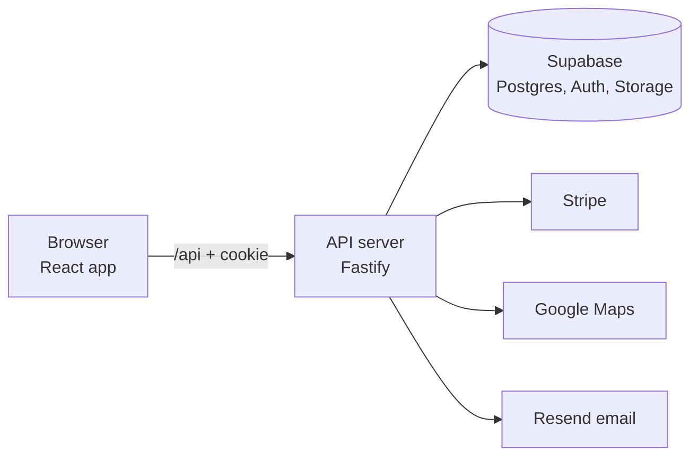

# Preppers

Home-cooked meal prep, made by people near you.

Preppers is a marketplace for home cooks ("Preppers") to sell meal prep to busy people nearby. Think Airtasker, but just for meal prep. It's a hobby project, built in small stages to learn full-stack development.

> "Prepping in Australia is distinctive: less about guns and militias, more about food, water and community. This difference matters, because the threats most Australians imagine are not urban shootouts or civil war. Increasingly, they imagine frequent floods, bushfires, heatwaves and supply-chain breakdowns."

> — Tom Doig and Jordan McKenzie, [What is prepping – and how does it work in Australia?](https://theconversation.com/what-is-prepping-and-how-does-it-work-in-australia-264481), The Conversation

[](https://www.youtube.com/watch?v=2-2KPErgzWs)

## What it does

**For buyers**

- Browse local Preppers by cuisine, dietary needs and distance.
- See which Preppers deliver to you.
- Fill one cart with meals from several Preppers and pay once.
- Get one receipt, grouped by Prepper.
- Review meals you've bought and save favourite Preppers and meals.

**For Preppers**

- Sign up, add your kitchen location and cuisines, and choose whether you deliver.
- Pass a food safety check before you can sell.
- List meals with photos, prices and dietary tags. Show, hide or archive them anytime.
- Get paid through Stripe and mark orders as handed over.

**For admins**

- Manage accounts, review Preppers licences and flag products. Admins are a separate account type: they can't buy or sell.
- See all purchases.

## How it's built



1. The React app in the browser only talks to our own API.
2. The API checks who you are, applies the business rules and talks to the database and outside services.
3. Secret keys never reach the browser.

| Part                     | Tools                                                     |
| ------------------------ | --------------------------------------------------------- |
| Web app (`web`)          | React, Vite, TypeScript, TanStack Router, Query and Table, Tailwind CSS + shadcn/ui |
| API (`api`)              | Node, Fastify, TypeScript, Drizzle                        |
| End-to-end tests (`e2e`) | Playwright with plain-English scenarios and video         |
| Database and sign-in     | Supabase (Postgres, Auth, Storage)                        |
| Payments                 | Stripe (test mode) with Connect payouts                   |
| Maps                     | Google Maps and Geocoding                                 |
| Email                    | Resend                                                    |
| Errors                   | Sentry                                                    |
| Hosting                  | Vercel                                                    |

## Getting started

> Setup steps are added as the project is built. This section is filled in at stage 0.1.

You'll need:

- Node.js (version set in each app's `.nvmrc`)
- pnpm
- Docker (for local Supabase)
- The Supabase CLI

The web app and API are separate projects with their own dependencies. Set up each one:

1. **API:** in `api`, run `pnpm install`, copy `.env.example` to `.env`, run `pnpm db:reset`, then `pnpm dev`.
2. **Web app:** in a second terminal, in `web`, run `pnpm install`, copy `.env.example` to `.env`, then `pnpm dev`.
3. Open the web app's local address. Its `/api` calls are forwarded to the API.

Each app's own README has the details.

## Project layout

```text
preppers/
├── web/              the React app (see web/README.md)
├── api/              the API server (see api/README.md)
├── e2e/              end-to-end tests with video
└── docs/
    ├── plan/         the build plan
    ├── features/     how each stage is built
    ├── data-model/   one page per database table
    └── adr/          decisions and why we made them
```

Each app is self-contained: its own dependencies, tests and deploy. The root holds the docs that span the whole product.

## Project status

Planning is done. Building starts at stage 0.1. Progress is tracked in the [stages checklist](docs/plan/08-stages.md).

## Read more

- [Build plan](docs/plan/00-overview.md)
- [Business rules](docs/plan/04-business-rules.md)
- [Data model](docs/plan/06-data-model.md)
- [Testing and critical paths](docs/plan/12-testing.md)
- [Decisions](docs/plan/11-decision-log.md)

## A note on AI

This project is built by a person, with Claude helping to plan, review code and keep docs up to date. Files named `CLAUDE.md` are instructions for Claude, not for people.
