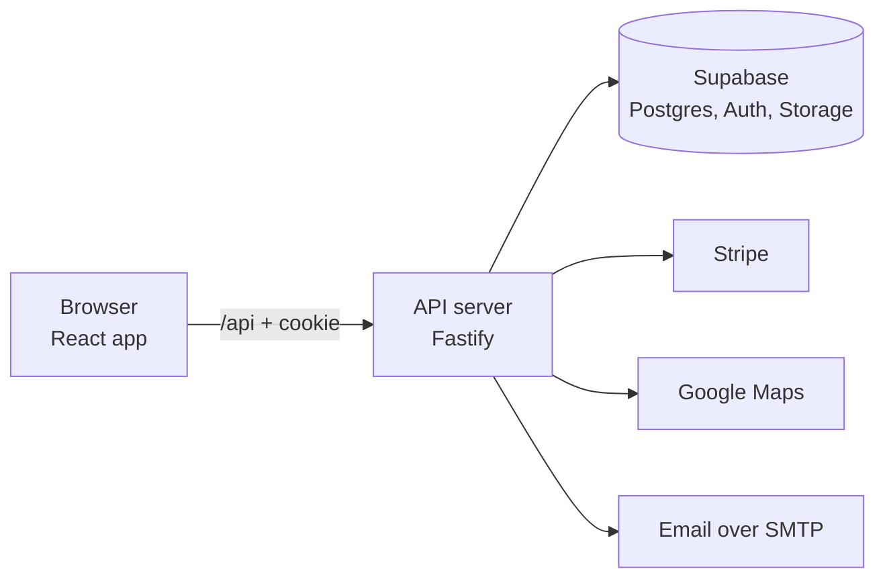

# Preppers

Home-cooked meal prep, made by people near you.

Preppers is a marketplace for home cooks ("Preppers") to sell meal prep to busy people nearby. Think Airtasker, but just for meal prep. It's a hobby project, built in small stages with Claude Code, to learn full-stack development and how to get test-driven, reliable, high-quality work out of an AI coding agent.

> "Prepping in Australia is distinctive: less about guns and militias, more about food, water and community. This difference matters, because the threats most Australians imagine are not urban shootouts or civil war. Increasingly, they imagine frequent floods, bushfires, heatwaves and supply-chain breakdowns."

> — Tom Doig and Jordan McKenzie, [What is prepping – and how does it work in Australia?](https://theconversation.com/what-is-prepping-and-how-does-it-work-in-australia-264481), The Conversation

[](https://www.youtube.com/watch?v=2-2KPErgzWs)

## What it does

**For buyers**

- Browse local Preppers by cuisine, dietary needs and distance.
- See which Preppers deliver to you.
- Fill one cart with meals from several Preppers and pay once.
- Get one receipt, grouped by Prepper.
- Review meals you've bought and save favourite Preppers and meals.

**For Preppers**

- Sign up, add your kitchen location and cuisines, and choose whether you deliver.
- Pass a food safety check before you can sell.
- List meals with photos, prices and dietary tags. Show, hide or archive them anytime.
- Get paid through Stripe and mark orders as handed over.

**For admins**

- Manage accounts, review Preppers licences and flag meals. Admins are a separate account type: they can't buy or sell.
- See all purchases.

## How it's built



1. The React app in the browser only talks to our own API.
2. The API checks who you are, applies the business rules and talks to the database and outside services.
3. Secret keys never reach the browser.

| Part                     | Tools                                                     |
| ------------------------ | --------------------------------------------------------- |
| Web app (`web`)          | React, Vite, TypeScript, TanStack Router, Query and Table, Tailwind CSS + shadcn/ui |
| API (`api`)              | Node, Fastify, TypeScript, Drizzle                        |
| End-to-end tests (`e2e`) | Playwright with plain-English scenarios and video         |
| Database and sign-in     | Supabase (Postgres, Auth, Storage)                        |
| Payments                 | Stripe (test mode), one platform account                |
| Maps                     | Google Maps and Geocoding                                 |
| Email                    | SMTP through a dedicated Gmail account (Resend later)     |
| Errors                   | Sentry                                                    |
| Hosting                  | Vercel                                                    |

## Getting started

> Setup steps are added as the project is built. This section is filled in at stage 0.1.

You'll need:

- Node.js (version set in each app's `.nvmrc`)
- npm
- Docker (for local Supabase)
- The Supabase CLI

The web app and API are separate projects with their own dependencies. Set up each one:

1. **API:** in `api`, run `npm install`, copy `.env.example` to `.env`, run `npm run db:reset`, then `npm run dev`.
2. **Web app:** in a second terminal, in `web`, run `npm install`, copy `.env.example` to `.env`, then `npm run dev`.
3. Open the web app's local address. Its `/api` calls are forwarded to the API.

Each app's own README has the details.

## Project layout

```text
preppers/
├── web/              the React app (see web/README.md)
├── api/              the API server (see api/README.md)
├── e2e/              end-to-end tests with video
└── docs/
    ├── plan/         the build plan
    ├── features/     how each stage is built
    ├── data-model/   one page per database table
    └── adr/          decisions and why we made them
```

Each app is self-contained: its own dependencies, tests and deploy. The root holds the docs that span the whole product.

## Email account

Sign-in codes and other app emails are sent from one Gmail account made just for this project: **preppers.au@gmail.com**.

- It sends mail only. Nobody needs to read or reply to it, but check it now and then for warnings from Google.
- Set it up at stage 1.5: turn on 2-Step Verification, then create an app password. See [stage 1.5](docs/plan/08-stages.md) for the Supabase settings.
- The app password is a secret. It lives only in Supabase's SMTP settings and in the API's `SMTP_PASS` setting on Vercel. It is never written in the repo.
- Changing this Gmail account's password cancels its app passwords. Make a new one and update both places.
- Gmail has a daily sending limit and codes can land in spam, so tell testers to check there.
- If the project ever needs a custom domain, switch to Resend. No app code changes.

## Project status

Planning is done. Building starts at stage 0.1. Progress is tracked in the [stages checklist](docs/plan/08-stages.md).

## Read more

- [Build plan](docs/plan/00-overview.md)
- [Business rules](docs/plan/04-business-rules.md)
- [Data model](docs/plan/06-data-model.md)
- [Testing and critical paths](docs/plan/12-testing.md)
- [Decisions](docs/plan/11-decision-log.md)

## A note on AI

Claude Code writes the code, tests and docs for this project, one small step at a time. Rachel sets the scope, approves each plan and test list, reviews every diff, and commits and pushes. Claude never commits. Files named `CLAUDE.md` are instructions for Claude, not for people.

### Claude helpers (subagents)

Three Claude Code helpers live in `.claude/agents/`. Each one starts fresh, without the planning chat, so it checks the work with fresh eyes. Run `/agents` in Claude Code to see them.

| Helper | What it does | Changes files? |
| --- | --- | --- |
| `test-writer` | Writes failing tests and `e2e` scenarios from a feature doc, then keeps the tests healthy after each change | Test files only |
| `code-reviewer` | Reviews a stage against its feature doc and the review rules | No |
| `docs-checker` | Checks the docs are easy to read and still match the code | No |

Claude runs them on its own for every stage, feature, adjustment and bug fix (see [How we work](docs/plan/01-how-we-work.md)):

1. **Before building:** `test-writer` writes failing tests from the feature doc. You OK the list of behaviours and commit the tests.
2. **Claude builds** until the tests pass.
3. **After the change:** `test-writer` reruns all tests, updates only the ones the feature doc says should change, fixes flaky ones, reports likely bugs, and suggests up to 3 new edge cases.
4. **Review:** `code-reviewer` and `docs-checker` run in parallel, and Claude fixes what they find.
5. **Finish:** Claude presents the uncommitted diff. You review it, ask Claude anything, approve the doc changes, then commit and push. The next stage starts in a fresh session.

You can also call one by name, e.g. "Run the docs-checker on stage 2.3".

Tips:

- The helpers can't see the chat, so Claude always passes them the feature doc.
- You commit the tests before the code is built, so any later change to them shows in the diff.
- The test-writer never loosens a test to make it pass. Likely bugs and new edge cases come back to you to decide.
- Skip the helpers for tiny changes. Just run the tests.
