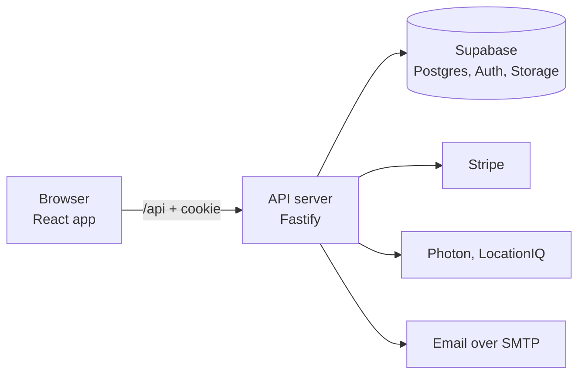

# Preppers

Home-cooked meal prep, made by people near you.

Preppers is a marketplace for home cooks ("Preppers") to sell meal prep to busy people nearby. Think Airtasker, but just for meal prep. It's a hobby proof of concept, built in small stages with Claude Code, to learn full-stack development and how to get test-driven, reliable, high-quality work out of an AI coding agent.

> "Prepping in Australia is distinctive: less about guns and militias, more about food, water and community. This difference matters, because the threats most Australians imagine are not urban shootouts or civil war. Increasingly, they imagine frequent floods, bushfires, heatwaves and supply-chain breakdowns."

> — Tom Doig and Jordan McKenzie, [What is prepping – and how does it work in Australia?](https://theconversation.com/what-is-prepping-and-how-does-it-work-in-australia-264481), The Conversation

## What it does

**For buyers**

- Browse local Preppers by cuisine, dietary needs and distance.
- Fill one cart with meals from several Preppers and pay once.
- Choose pickup or delivery for each Prepper.
- Get one receipt by email, grouped by Prepper.
- Review meals you've bought and save favourite Preppers and meals.

**For Preppers**

- Sign up, add your kitchen and cuisines, and choose whether you deliver.
- Pass a food safety check before you can sell.
- List meals with photos, prices and dietary tags. Show, hide or archive them anytime.
- Get an email for each new order, mark it handed over, and get paid outside the app.

**For admins**

- Manage accounts, review food safety checks, and flag or feature meals. Admins can't buy or sell.
- See all purchases and record Prepper payouts.

## How it's built

The browser only talks to our API. The API checks who you are, applies the business rules and holds every secret. Details: [architecture](docs/architecture.md).

## Getting started

You'll need Node (version in each app's `.nvmrc`), npm, Docker Desktop (runs local Supabase) and the Supabase CLI.

1. **API:** in `api`, run `npm install`, copy `.env.example` to `.env`, run `npm run db:reset`, then `npm run dev`.
2. **Web:** in `web`, run `npm install`, copy `.env.example` to `.env`, then `npm run dev`.
3. Open the web app's local address. Its `/api` calls go to the API.

Each app's README has the details.

## Docs

| Doc | Holds |
| --- | --- |
| [CONTEXT.md](CONTEXT.md) | Glossary |
| [Architecture](docs/architecture.md) | Services, contract, free tiers, security |
| [Rules](docs/rules.md) | Business rules and what's not in v1 |
| [Data model](docs/data-model.md) | Tables, enums, status moves |
| [Stages](docs/stages.md) | Build scope and progress |
| [Auth](docs/auth.md) | Sessions, guards, routes |
| [Wireframes](https://claude.ai/artifact/8KZKfE2Ajo2BXPqRxwciT3#d43ae32e-e1a6) | All 17 screens. The only copy |
| [Testing](docs/testing.md) | TDD, critical paths |
| [ADRs](docs/adr/) | Decisions and why |
| [Feature docs](docs/features/) | Detailed plans for payments, auth and migrations |

## How we work

Claude Code writes the code, tests and docs, test first. Rachel sets the scope, approves plans, reviews every diff, and commits and pushes. Claude never commits. The workflow is in [CLAUDE.md](CLAUDE.md); `CLAUDE.md` and `AGENTS.md` files are instructions for Claude.

## Status

Planning is done. Building starts at stage 0.1. Progress: [stages](docs/stages.md).
