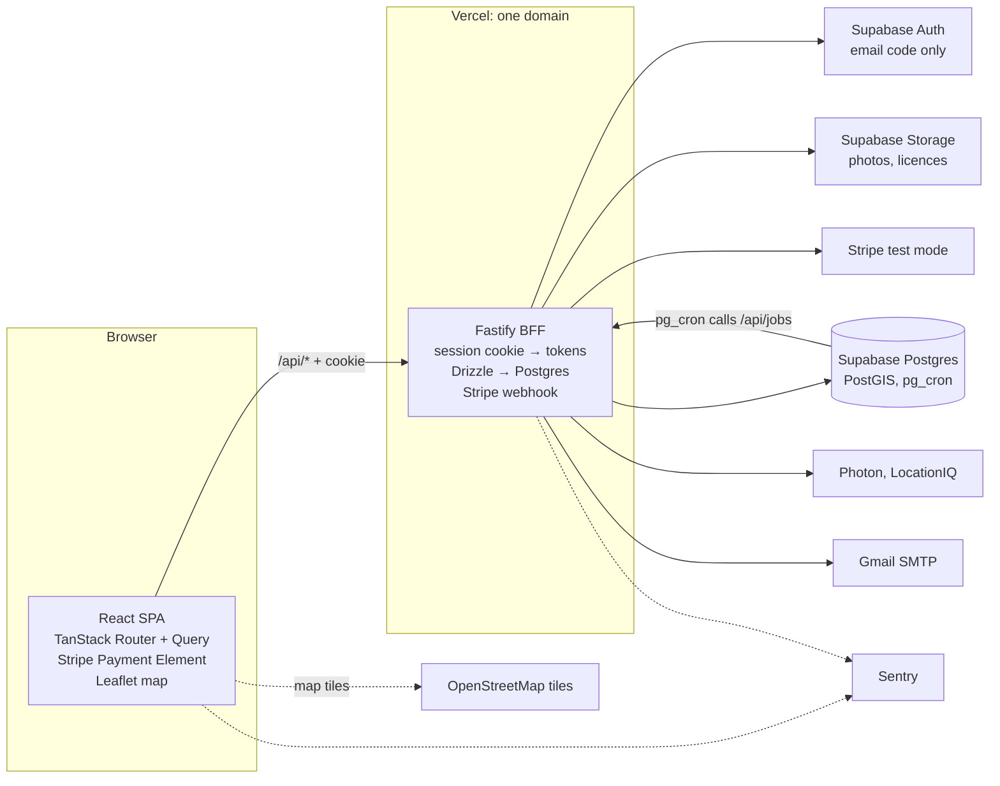
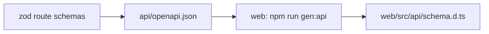

# Architecture

Only the API (a Fastify BFF) holds secrets and talks to outside services. The browser holds a session cookie and no secrets.



## A request

1. The browser calls `/api/...` with only a session cookie. The web project on Vercel forwards it to the api project, so it's one site.
2. The API checks the cookie locally and loads the account; guards allow or refuse by role. See [auth.md](auth.md).
3. The API calls the database or an outside service with its own keys and returns JSON.
4. Errors on either side go to Sentry with the same request ID.

## Tools

| Area | Choice |
| --- | --- |
| Web | React, Vite, TypeScript, TanStack Router, Query and Table, React Hook Form + zod, Tailwind + shadcn/ui |
| API | Node, Fastify, TypeScript, Drizzle, pino |
| Database | Supabase Postgres, PostGIS for distance, migrations in git |
| Sign-in | Supabase Auth, email code only, called only by the API |
| Files | Supabase Storage: public bucket for meal photos, private for licences |
| Payments | Stripe test mode, one platform account; Preppers paid outside the app |
| Email | Outbox table, sent over SMTP from preppers.au@gmail.com; sign-in codes through Supabase's SMTP settings |
| Places | Suburb search and street addresses: Photon, then LocationIQ. See [ADR 0015](adr/0015-open-maps-and-places.md) |
| Map | Leaflet with OpenStreetMap tiles |
| Errors | Sentry |
| Tests | Vitest, Testing Library, MSW, Fastify `inject`; Playwright + playwright-bdd. See [testing.md](testing.md) |
| Hosting | Vercel (two projects), Supabase cloud |

## Repo

```text
preppers/
├── CLAUDE.md, AGENTS.md   instructions for Claude
├── CONTEXT.md             glossary
├── docs/                  product docs, ADRs, feature docs
├── api/                   Fastify BFF → Vercel project "preppers-api"
├── web/                   React SPA → Vercel project "preppers-web"
└── e2e/                   Playwright critical paths
```

- Each app has its own `package.json`, lockfile, tooling and tests. No app imports another; no root `package.json`. See [ADR 0009](adr/0009-self-contained-apps.md).
- Each Vercel project's Root Directory is its app folder, so Vercel never treats the root `api/` as functions. It rebuilds only when its folder changes (`git diff --quiet HEAD^ HEAD -- .`).

## Contract between web and api



1. Every route declares zod schemas for params, body and response.
2. `npm run openapi` in `api` writes `openapi.json` (committed).
3. `npm run gen:api` in `web` writes `src/api/schema.d.ts`.
4. CI regenerates both and fails if either changed.

## Running as a Vercel Function

- Nothing kept in memory between requests, so rate-limit counts live in the database.
- No background workers. Supabase `pg_cron` calls `/api/jobs/*`, protected by `JOBS_SECRET`.
- The Stripe webhook route alone gets the raw-body parser.
- A weekly GitHub Actions ping stops Supabase pausing.

## Free tiers

No service needs a card. Check limits again before launch.

- **Vercel Hobby:** personal, non-commercial only; move to Pro before taking real money. Its terms allow using deployed content for AI training, so keep user data out of code.
- **Supabase free:** 500 MB database, 1 GB files; pauses after 7 days idle.
- **Stripe:** test mode is free.
- **Gmail SMTP:** daily send cap; codes can land in spam. Resend (3,000 a month, needs a domain) is the upgrade.
- **Sentry Developer:** 1 user, 5,000 errors a month.
- **Photon (public):** fair use, no published quota or SLA. Low volume because searches run on submit and answers are saved.
- **LocationIQ free:** about 5,000 requests a day, 2 a second; needs a visible attribution link.
- **OpenStreetMap tiles:** light use only; attribution required.
- **GitHub Actions:** free minutes are enough.

## Security

- Two-factor sign-in on GitHub, Vercel, Supabase, Stripe, LocationIQ, the Gmail account and Sentry.
- Secrets live in host settings, never in the repo or the browser.
- Row-level security on every table, with no policies; the Supabase Data API off; every query through Drizzle.
- LocationIQ key server-only. Photon calls identify the app in their user agent.
- Stripe test keys only; every webhook signature checked.
- Sign-in limits (1.2) and checkout limits and headers (8.3) matter more without a paid firewall.
