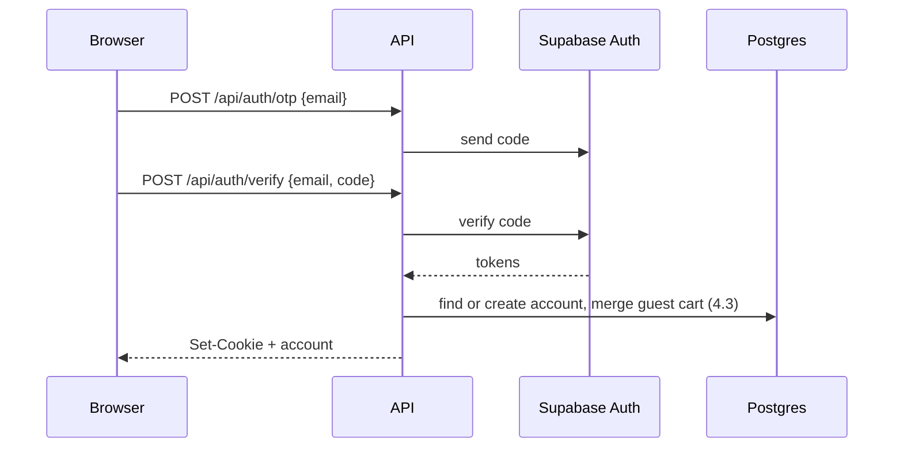

# Authentication

How sign-in state is kept, checked and used to protect routes. Why: [ADR 0013](adr/0013-session-cookie-and-getclaims.md). Stages 1.1–1.4, 2.1.

## In short

1. The browser only talks to our API, never to Supabase.
2. After sign-in it holds httpOnly session cookies. JavaScript can't read them.
3. Every request: the API checks the token locally with `getClaims()` and loads the account.
4. Each route is public, needs a session, or needs a role.
5. The web app caches `GET /api/me` and redirects with it. That's for a good experience only; the API keeps data safe.

## Access levels

- **Public:** anyone.
- **Guest only:** signed out; signed-in people go to their home page.
- **Signed in:** any valid session.
- **Buyer:** `accountType = buyer`.
- **Prepper:** a buyer with a Prepper profile, any food safety status.
- **Admin:** `accountType = admin`.

Preppers can use every buyer page. Admins can view public pages but can't buy, sell, hold a cart or save favourites.

## Web routes

| Route | Screen | Access |
| --- | --- | --- |
| `/`, `/meals`, `/meals/$id` | [W1](https://claude.ai/artifact/8KZKfE2Ajo2BXPqRxwciT3#d43ae32e-e1a6), [W2](https://claude.ai/artifact/8KZKfE2Ajo2BXPqRxwciT3#d43ae32e-e1a6), [W3](https://claude.ai/artifact/8KZKfE2Ajo2BXPqRxwciT3#d43ae32e-e1a6) | Public |
| `/preppers`, `/preppers/$id` | [W17](https://claude.ai/artifact/8KZKfE2Ajo2BXPqRxwciT3#d43ae32e-e1a6), [W4](https://claude.ai/artifact/8KZKfE2Ajo2BXPqRxwciT3#d43ae32e-e1a6) (unknown or unverified: 404) | Public |
| Cart drawer | [W5](https://claude.ai/artifact/8KZKfE2Ajo2BXPqRxwciT3#d43ae32e-e1a6) | Public (guest-token cookie) |
| `/sign-in` | [W6](https://claude.ai/artifact/8KZKfE2Ajo2BXPqRxwciT3#d43ae32e-e1a6) steps 1–2, accepts `?redirect=` | Guest only |
| `/welcome` | [W6](https://claude.ai/artifact/8KZKfE2Ajo2BXPqRxwciT3#d43ae32e-e1a6) About you, first sign-in only | Signed in |
| `/checkout`, `/checkout/paid`, `/checkout/failed` | [W7](https://claude.ai/artifact/8KZKfE2Ajo2BXPqRxwciT3#d43ae32e-e1a6) | Buyer |
| `/account`, `/account/receipts`, `/account/receipts/$id`, `/account/favourites` | [W8](https://claude.ai/artifact/8KZKfE2Ajo2BXPqRxwciT3#d43ae32e-e1a6), [W9](https://claude.ai/artifact/8KZKfE2Ajo2BXPqRxwciT3#d43ae32e-e1a6) | Buyer |
| `/sell/sign-up` | [W10](https://claude.ai/artifact/8KZKfE2Ajo2BXPqRxwciT3#d43ae32e-e1a6) | Buyer without a verified profile |
| `/sell`, `/sell/invoices`, `/sell/meals`, `/sell/kitchen`, `/sell/food-safety` | [W11](https://claude.ai/artifact/8KZKfE2Ajo2BXPqRxwciT3#d43ae32e-e1a6), [W12](https://claude.ai/artifact/8KZKfE2Ajo2BXPqRxwciT3#d43ae32e-e1a6), [W10](https://claude.ai/artifact/8KZKfE2Ajo2BXPqRxwciT3#d43ae32e-e1a6) forms | Prepper (rejected: meals read-only) |
| `/admin/meals`, `/admin/preppers`, `/admin/buyers`, `/admin/purchases` and details | [W13](https://claude.ai/artifact/8KZKfE2Ajo2BXPqRxwciT3#d43ae32e-e1a6)–[W16](https://claude.ai/artifact/8KZKfE2Ajo2BXPqRxwciT3#d43ae32e-e1a6) | Admin |
| `/forbidden` | Not allowed | Signed in |

**Per role on public pages.** Controls are hidden, not disabled.

| Control | Guest | Buyer or Prepper | Admin |
| --- | --- | --- | --- |
| Cart, Add to cart | Shown | Shown | Hidden |
| Favourite heart | Asks to sign in | Shown | Hidden |
| Header | Meals, Preppers | Meals, Preppers | + Admin |
| Account menu | Sign in | Account, Start selling or Sell, Sign out | Name, Invite admin, Sign out |
| `/account`, `/checkout`, `/sell/*` | Sign in first | By role | `/admin/meals` |

Save, Check out and Start selling are actions on public pages: guests are sent to sign in, then back.

## API routes

| Route | Guard |
| --- | --- |
| `GET /api/meals`, `GET /api/preppers`, `GET /api/places` | None (may use the account if present) |
| `/api/auth/*` | None |
| `GET /api/me` | `requireSession`; 401 means signed out |
| `/api/cart/*` | Session or guest cookie; admins refused |
| `/api/checkout/*`, `/api/orders/*`, `GET /api/places/addresses` | `requireBuyer` |
| `/api/sell/*` | `requirePrepper` (profile creation: `requireBuyer`) |
| `/api/admin/*` | `requireAdmin` on the whole prefix |
| `POST /api/webhooks/stripe` | Stripe signature on the raw body |
| `/api/jobs/*` | `JOBS_SECRET` header |

## Guards

| Guard | Rejects | When |
| --- | --- | --- |
| `requireSession` | 401 | No valid session |
| any guard | 403 `account_deactivated` | Account deactivated |
| `requireBuyer` | 403 | Not a buyer (refuses admins) |
| `requirePrepper` | 403 | No Prepper profile |
| `requireMealEditor` | 403 | Profile `rejected`; used on meal create and edit |
| `requireAdmin` | 403 | Not an admin |

- **401:** "I don't know who you are". The web app sends you to sign in.
- **403:** "You can't do this". Signing in again won't help.
- `own_meal` (422) isn't a guard: cart, merge and checkout handlers compare the meal's Prepper with the session's.

## Data access

1. Account and Prepper IDs come from the session, never the body or URL.
2. Scope every query by the session's account, so someone else's record can't match:

   ```ts
   where(and(eq(orders.id, orderId), eq(orders.accountId, request.account.id)))
   ```

3. Someone else's record answers 404, the same as a missing one.
4. Tokens and sessions are never in a response, log or admin view.
5. Admin routes have their own response schemas.
6. Public pages get public fields only: suburb, not address or position; no email or licence.

## The authenticate hook

Runs on every request and never rejects.

1. Read the session cookie.
2. Check the access token with `getClaims()`: local signature check, no network call, provided Supabase uses asymmetric JWT signing keys (check in 1.2).
3. If expired, refresh and set new cookies.
4. Load the account by lowercase email, with its type, status and Prepper profile.
5. Set `request.account`, or `null`.

An access token stays valid until expiry (default 1 hour) after sign-out; the account lookup still blocks deactivated accounts at once. Supabase's public keys may be cached in memory: they aren't user state.

## Cookies

- Chunked httpOnly cookies, using [`@supabase/ssr`](https://supabase.com/docs/guides/auth/server-side).
- `HttpOnly`, `Secure`, `SameSite=Lax`, `Path=/`; first-party because web and api share a domain.
- State-changing routes check the `Origin` header.

## Web route guards

```text
__root.tsx     context: { queryClient }
_public/       no guard
_guest/        signed in → role home
_auth/         signed out → /sign-in?redirect=<page>
  _buyer/      buyer
  _prepper/    buyer with a Prepper profile (2.1)
  _admin/      admin
```

1. Each layout's `beforeLoad` calls `queryClient.ensureQueryData(meQuery)`.
2. `/api/me` answers `{ id, name, accountType, prepperProfile: { status } | null }`.
3. A failed check throws `redirect`. Protected layouts show a spinner while `/me` loads.
4. After sign-in or sign-out: invalidate `me`, then `router.invalidate()`.
5. The API client handles 401 for every call: clear `me`, go to sign in.
6. `redirect` must start with `/` and not `//`. For admins, only public pages or `/admin/*`.

## Sign-in flow



A deactivated account is refused with 403 after the code step.

## Sign-in limits (1.2)

- Counted in the database. Start with 5 code requests per email and 20 per IP in 15 minutes; 5 wrong codes, then a 15-minute wait.
- Over the limit: 429 with "too many tries, wait a few minutes". Never reveals whether the email has an account.

## Tests to expect

1. Every guarded route: no session 401, wrong role 403, deactivated 403, allowed.
2. Every route returning a record: another buyer or Prepper gets 404; admin responses hold no auth fields.
3. Sessions: valid, refreshed, revoked, missing, deactivated; limits 429 and reset.
4. Web: each layout redirects; unsafe `redirect` ignored; admin redirect to a buyer page goes to `/admin/meals`.
