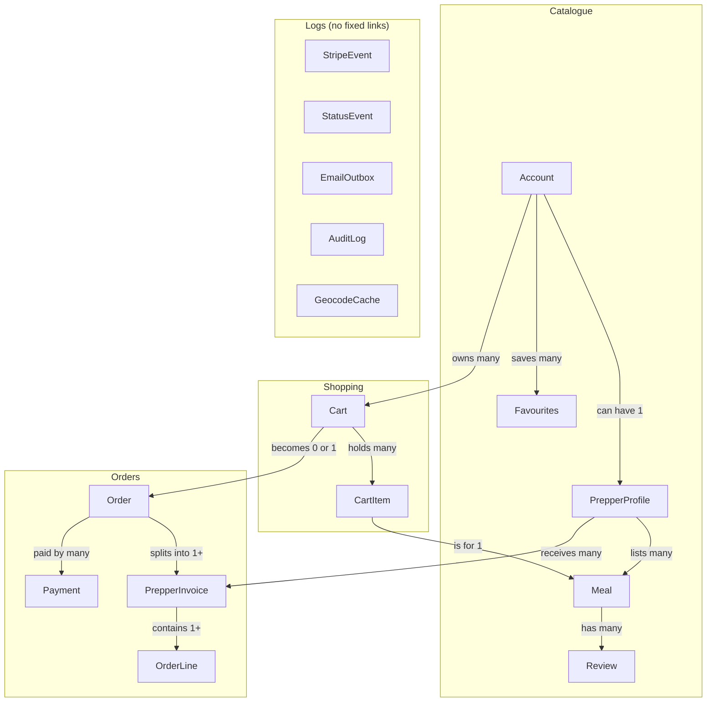
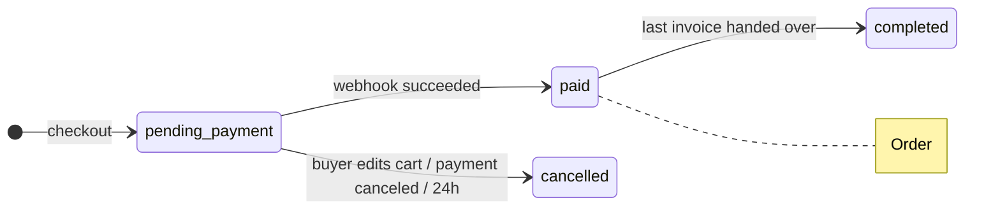
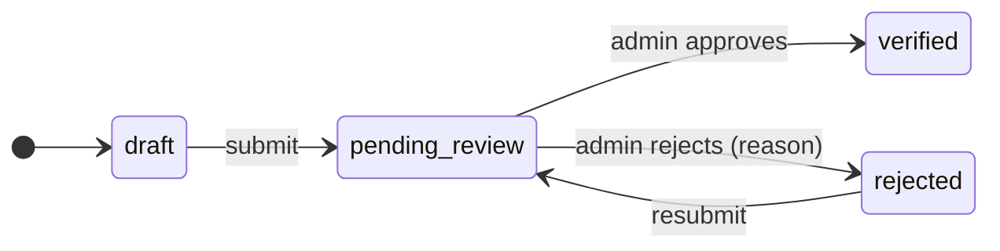

# Data model

Tables, enums and status moves. Rules: [rules.md](rules.md). Terms: [CONTEXT.md](../CONTEXT.md).

## Conventions

- Every table has `id` (uuid), `createdAt` and `updatedAt` unless its table says otherwise.
- Postgres: `snake_case` plural tables, `snake_case` columns. Drizzle maps them to `camelCase`.
- Money: whole cents (`int`), always AUD.
- Time: `timestamptz` in UTC; the API sends ISO 8601 ending in `Z`; the web shows `Australia/Brisbane`. Date only: `date`, `YYYY-MM-DD`. See [ADR 0007](adr/0007-timestamps-utc.md).
- Positions: PostGIS `geography(Point, 4326)` with a GiST index.
- Enums live in the API's zod schemas and reach web through the OpenAPI types. Display labels live in web.

## Common types

- `DietaryTag`: vegetarian, vegan, gluten_free, dairy_free, nut_free, halal, kosher, low_carb
- `CuisineType`: australian, chinese, indian, italian, japanese, korean, mexican, middle_eastern, thai, vietnamese, other
- `AustralianState`: QLD, NSW, VIC, TAS, SA, WA, NT, ACT
- `HandoverMethod`: pickup, delivery

## Tables

### Account (0.3)

| Field | Type | Rules |
| --- | --- | --- |
| email | text, unique | lowercase |
| name | text | 1–80 characters |
| accountType | AccountType | set on create, never changes |
| status | AccountStatus | |
| suburb | text | optional |
| dietaryTags | DietaryTag[] | |

### PrepperProfile (2.1)

Key: `accountId` (PK, FK → Account). Never sent to the browser before payment: street, postcode, location, licence fields.

| Field | Type | Rules |
| --- | --- | --- |
| displayName | text | 1–60 characters |
| street, suburb, postcode, state | text, AustralianState | postcode 4 digits |
| location | geography | from the address lookup (2.3); GiST index (3.3) |
| cuisineTypes | CuisineType[] | at least 1 |
| canDeliver | boolean | |
| deliveryRadiusKm | int | 1–50, only if canDeliver |
| foodSafetyStatus | FoodSafetyStatus | starts `draft` |
| council, licenceNumber | text | |
| licenceExpiry | date | in the future when submitted |
| supervisorName, supervisorCertNumber | text | typed, not uploaded |
| licenceFilePath | text | private bucket |

### Meal (2.4)

| Field | Type | Rules |
| --- | --- | --- |
| prepperId | FK → PrepperProfile | from the session |
| name | text | 1–100 characters |
| description | text | up to 1,000 characters |
| ingredients | text[] | at least 1 |
| dietaryTags | DietaryTag[] | |
| priceCents | int | more than 0 |
| imageUrl | text | optional |
| status | MealStatus | |
| flagReason | text | set by an admin |
| featuredAt | timestamptz | empty = not featured |

### Review (6.2)

| Field | Type | Rules |
| --- | --- | --- |
| mealId | FK → Meal | |
| buyerId | FK → Account | from the session |
| orderLineId | FK → OrderLine, unique | one review per line |
| rating | int | 1–5 |
| comment | text | 1–1,000 characters |

### FavouritePrepper, FavouriteMeal (6.3)

Key: `accountId` + `prepperId` (or `mealId`). Only `createdAt`.

### Cart (4.1)

| Field | Type | Rules |
| --- | --- | --- |
| accountId | FK → Account | empty for guests |
| guestTokenHash | text, unique | empty when signed in |
| status | CartStatus | one `active` cart per account |

`updatedAt` changes on every edit; the 1-hour guest expiry counts from it.

### CartItem (4.1)

Key: `cartId` + `mealId`. Field: `quantity` (1–20).

### Order (5.1)

| Field | Type | Rules |
| --- | --- | --- |
| buyerId | FK → Account | |
| cartId | FK → Cart, unique | one order per cart |
| status | OrderStatus | |
| totalCents | int | sum of its invoices |
| deliveryAddress | text | empty if every invoice is pickup |
| deliveryLocation | geography | from the address lookup |
| paidAt | timestamptz | set by the webhook |

### PrepperInvoice (5.1)

One per Prepper per order. Snapshots are copied at checkout and never change.

| Field | Type | Rules |
| --- | --- | --- |
| orderId | FK → Order | |
| prepperId | FK → PrepperProfile | |
| status | InvoiceStatus | |
| totalCents | int | what the Prepper is owed |
| handoverMethod | HandoverMethod | |
| handoverAddress | text | snapshot: Prepper's address or the delivery address |
| buyerEmail, prepperEmail | text | snapshots |
| payStatus | PayStatus | set by an admin |
| handedOverAt, paidOutAt | timestamptz | optional |

### OrderLine (5.1)

| Field | Type | Rules |
| --- | --- | --- |
| invoiceId | FK → PrepperInvoice | |
| mealId | FK → Meal | |
| nameSnapshot | text | copied at checkout |
| unitPriceCentsSnapshot | int | copied at checkout |
| quantity | int | 1–20 |
| lineTotalCents | int | unit price × quantity |

### Payment (5.3)

| Field | Type | Rules |
| --- | --- | --- |
| orderId | FK → Order | one open payment per order |
| stripePaymentIntentId | text, unique | |
| amountCents | int | from the order |
| status | PaymentStatus | changed only by webhook events |
| lastErrorCode | text | optional |

### StripeEvent (5.5)

Key: Stripe's event `id`. Fields: `type`, `processedAt`. Saved first in the webhook transaction; a known id is skipped.

### StatusEvent (0.6)

| Field | Type | Rules |
| --- | --- | --- |
| entityType, entityId | text, uuid | any status table; no fixed FK |
| fromStatus | text | empty on create |
| toStatus | text | |
| actorType | ActorType | |
| actorId | uuid | optional |
| reason | text | optional |

Never updated or deleted. Written in the same transaction as the change.

### EmailOutbox (5.5)

| Field | Type | Rules |
| --- | --- | --- |
| toAddress, template | text | |
| payload | jsonb | |
| idempotencyKey | text, unique | `template/entityId` |
| attempts | int | max 5 |
| lastError | text | optional |
| sentAt | timestamptz | empty until sent |

### AuditLog (7.2)

Fields: `adminId` (FK → Account), `action`, `targetType`, `targetId`, `detail` (jsonb), `createdAt`. Never updated or deleted.

### GeocodeCache (3.3)

Saved answers to suburb and postcode searches.

| Field | Type | Rules |
| --- | --- | --- |
| query | text, PK | trimmed, lowercase, e.g. `4101`, `west end qld` |
| location | geography | |
| label | text | e.g. "West End QLD 4101" |
| source | text | photon, locationiq |
| createdAt | timestamptz | expired per the provider's terms |

## Enums

| Enum | Values |
| --- | --- |
| AccountType | `buyer`, `admin` |
| AccountStatus | `active`, `deactivated` |
| FoodSafetyStatus | `draft`, `pending_review`, `verified`, `rejected` |
| MealStatus | `active`, `hidden`, `flagged`, `archived` |
| CartStatus | `active`, `checking_out`, `ordered`, `merged`, `abandoned` |
| OrderStatus | `pending_payment`, `paid`, `completed`, `cancelled` |
| InvoiceStatus | `pending_payment`, `paid`, `handed_over`, `cancelled` |
| PayStatus | `pending`, `paid_out` |
| PaymentStatus | Stripe's own: `requires_payment_method`, `requires_action`, `processing`, `succeeded`, `canceled` (one "l") |
| ActorType | `account`, `system` (scheduled job), `stripe` (webhook) |

## Status moves

- Allowed moves live in one map in `api/src/services/status.ts`.
- `transition(tx, entity, id, to, actor, reason?)` makes every change, writes a `StatusEvent` in the same transaction, and returns 409 for a move not on the map. See [ADR 0006](adr/0006-status-transitions-and-event-log.md).

| Entity | From → To | Actor |
| --- | --- | --- |
| Account | active ↔ deactivated (not admins) | admin |
| PrepperProfile | draft, rejected → pending_review | Prepper |
| PrepperProfile | pending_review → verified, rejected | admin |
| Meal | active ↔ hidden | Prepper |
| Meal | active, hidden → flagged; flagged → active | admin |
| Meal | active, hidden → archived | Prepper, admin |
| Meal | flagged → archived | admin |
| Cart | active → checking_out | buyer |
| Cart | checking_out → active | buyer, system |
| Cart | checking_out → ordered | stripe |
| Cart | active → merged, abandoned | system |
| Order | pending_payment → paid | stripe |
| Order | pending_payment → cancelled (not while payment `processing` or `succeeded`) | buyer, stripe, system |
| Order | paid → completed | system |
| PrepperInvoice | pending_payment → paid, cancelled | with its order |
| PrepperInvoice | paid → handed_over | Prepper |
| PrepperInvoice payStatus | pending → paid_out (invoice `paid` or `handed_over`) | admin |
| Payment | any → Stripe's new status | stripe |

### Checkout, step by step

1. Checkout: cart `active` → `checking_out`. Order and invoices are created `pending_payment`, and a Stripe payment starts.
2. Paying: 3DS and declines move the payment between `requires_payment_method`, `requires_action` and `processing`. The order stays `pending_payment`.
3. Buyer cancels to edit the cart: allowed unless the payment is `processing` or `succeeded`. The Stripe payment is cancelled first, then order and invoices → `cancelled`, cart → `active`.
4. Webhook `succeeded`, in one transaction: payment `succeeded`, order and invoices `paid`, cart `ordered`, payStatus `pending`, emails queued.
5. Payment `canceled`: order and invoices `cancelled`, cart `active`.
6. Each Prepper marks their invoice `handed_over`. The last one completes the order.
7. An admin pays each Prepper outside the app, then marks the invoice `paid_out`.
8. Still unpaid after 24 hours, payment not `processing`: a scheduled job cancels it.

### Food safety

