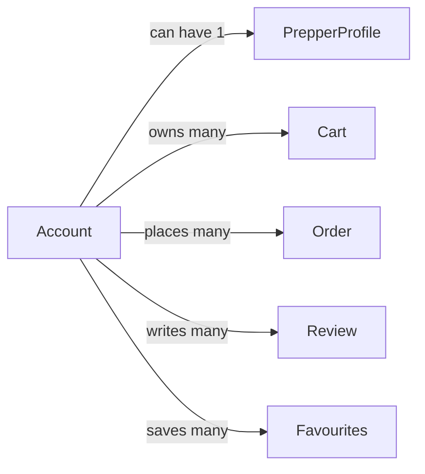

# Account

## Fields

| Field | Type | Key | Rules |
| --- | --- | --- | --- |
| id | uuid | PK |  |
| email | text | UK | stored lowercase |
| name | text |  | 1–80 characters |
| isAdmin | boolean |  | default false |
| status | AccountStatus |  | active, suspended, deleted |
| suburb | text |  | optional |
| dietaryTags | DietaryTag[] |  |  |
| createdAt | timestamptz |  |  |
| updatedAt | timestamptz |  |  |

## Links

- **Does:** signs in, edits own profile, buys, reviews, saves favourites.
- **Checks:** email unique; name 1–80 characters; suspended or deleted accounts can't sign in; an admin can't remove their own admin flag.
- **Built in:** 0.3, 1.1, 6.1, 7.2
- [Back to data model](../../plan/06-data-model.md)
