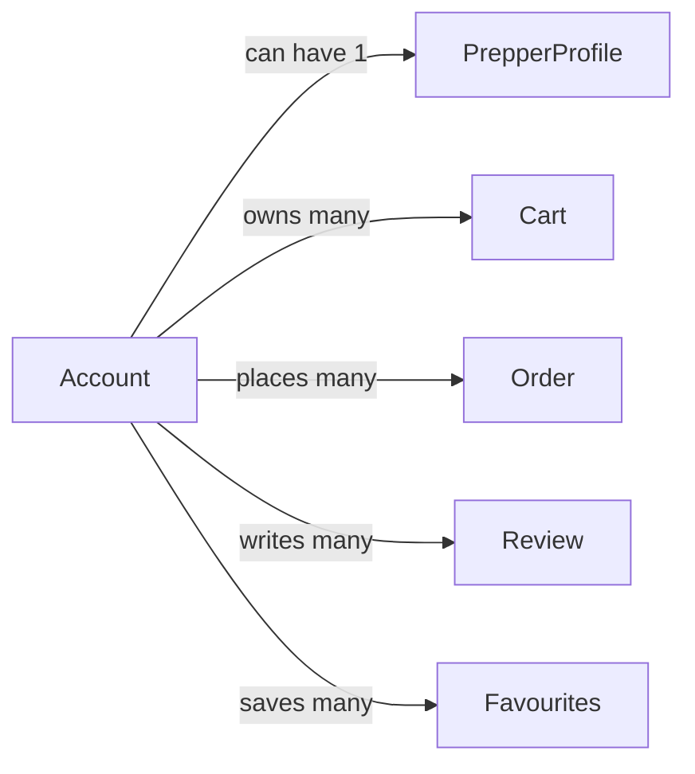

# Account

## Fields

| Field       | Type          | Key | Rules                      |
| ----------- | ------------- | --- | -------------------------- |
| id          | uuid          | PK  |                            |
| email       | text          | UK  | stored lowercase           |
| name        | text          |     | 1–80 characters            |
| accountType | AccountType   |     | buyer or admin; set when created |
| status      | AccountStatus |     | active, deactivated        |
| suburb      | text          |     | optional                   |
| dietaryTags | DietaryTag[]  |     |                            |
| createdAt   | timestamptz   |     |                            |
| updatedAt   | timestamptz   |     |                            |

## Links

- **Does:** signs in and edits own profile. Buyers also buy, review and save favourites. Admins do none of those.
- **Checks:** email unique; name 1–80 characters; only an admin deactivates or reactivates an account; a deactivated account can't sign in and keeps its details; type never changes in the app; an admin has no profile, carts, orders, reviews or favourites; admin accounts can't be deactivated or removed.
- **Built in:** 0.3, 1.1, 6.1, 7.2
- [Back to data model](../../plan/06-data-model.md)
