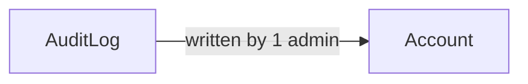

# AuditLog

## Fields

| Field | Type | Key | Rules |
| --- | --- | --- | --- |
| id | uuid | PK |  |
| adminId | uuid | FK → [Account](account.md) | must be an admin |
| action | text |  |  |
| targetType | text |  |  |
| targetId | uuid |  |  |
| detail | jsonb |  |  |
| createdAt | timestamptz |  |  |

## Links

- **Does:** records admin edits that aren't status changes.
- **Checks:** never updated or deleted; written for every admin edit.
- **Built in:** 7.2
- [Back to data model](../../plan/06-data-model.md)
