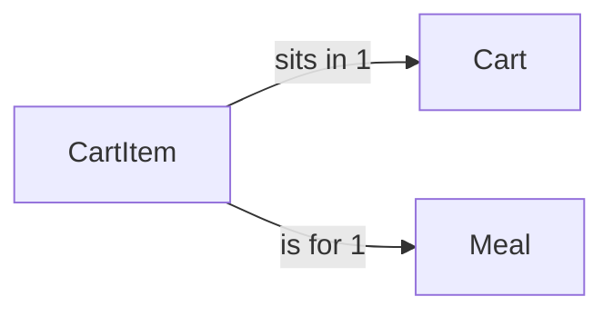

# CartItem

## Fields

| Field     | Type        | Key                            | Rules                  |
| --------- | ----------- | ------------------------------ | ---------------------- |
| cartId    | uuid        | PK, FK → [Cart](cart.md)       |                        |
| mealId | uuid        | PK, FK → [Meal](meal.md) | meal must be active |
| quantity  | int         |                                | 1–20                   |
| createdAt | timestamptz |                                |                        |
| updatedAt | timestamptz |                                |                        |

## Links

- **Does:** one meal and its quantity in a cart.
- **Checks:** quantity 1–20; a meal can only be added while it is `active` and its Prepper is `verified` with an active account. A line whose meal later stops being available stays, is shown disabled and is left out of totals, until checkout starts. Starting checkout deletes those lines.
- **Built in:** 4.1
- [Back to data model](../../plan/06-data-model.md)
