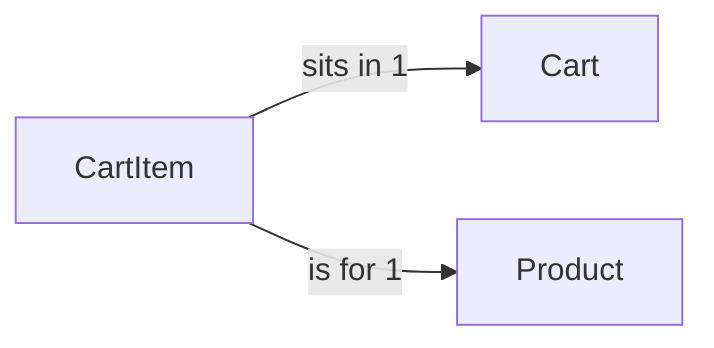

# CartItem

## Fields

| Field | Type | Key | Rules |
| --- | --- | --- | --- |
| cartId | uuid | PK, FK → [Cart](cart.md) |  |
| productId | uuid | PK, FK → [Product](product.md) | product must be active |
| quantity | int |  | 1–20 |
| createdAt | timestamptz |  |  |
| updatedAt | timestamptz |  |  |

## Links

- **Does:** one product and its quantity in a cart.
- **Checks:** quantity 1–20; the product is `active` and its prepper is `verified`.
- **Built in:** 4.1
- [Back to data model](../../plan/06-data-model.md)
