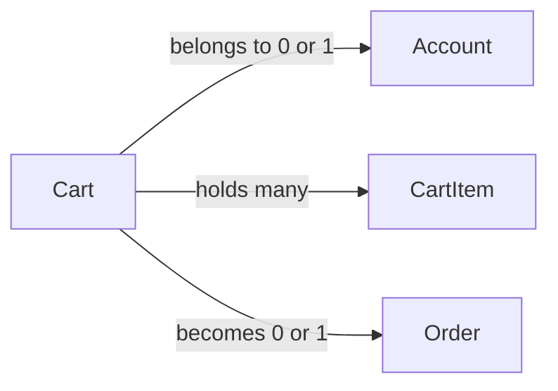

# Cart

## Fields

| Field | Type | Key | Rules |
| --- | --- | --- | --- |
| id | uuid | PK |  |
| accountId | uuid | FK → [Account](account.md) | empty for guests |
| guestTokenHash | text | UK | empty for signed-in users |
| status | CartStatus |  | active, checking_out, ordered, merged, abandoned |
| createdAt | timestamptz |  |  |
| updatedAt | timestamptz |  | changes on every cart edit; guest carts untouched for 1 hour are abandoned from this |

## Links

- **Does:** holds what a buyer or guest wants to buy.
- **Checks:** has either an account or a guest token, never both; one active cart per account; no changes while `checking_out`; subtotal worked out when read.
- **Built in:** 4.1–4.3, 5.1
- [Back to data model](../../plan/06-data-model.md)
