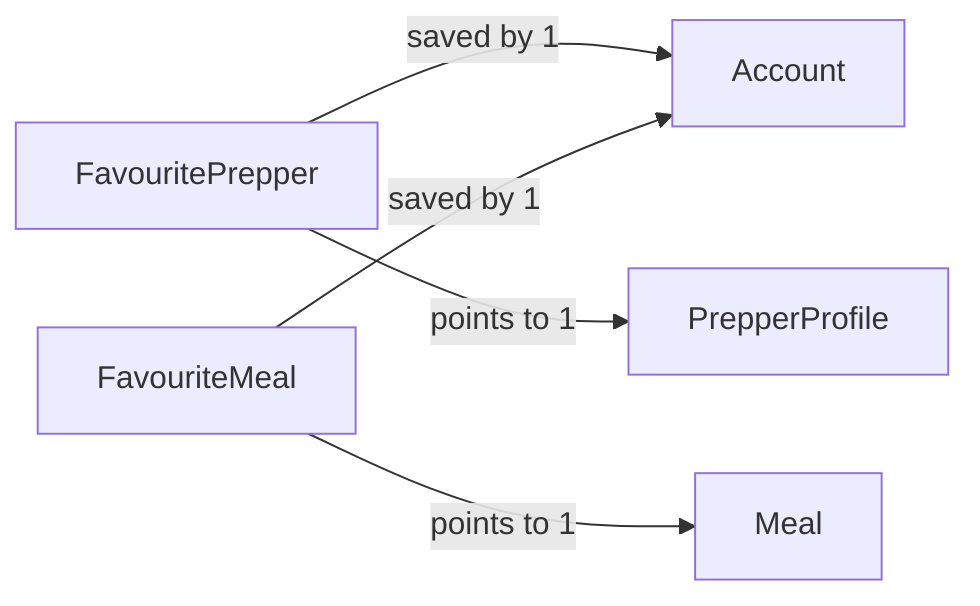

# Favourites

## Fields — FavouritePrepper

| Field      | Type        | Key                                             | Rules |
| ---------- | ----------- | ----------------------------------------------- | ----- |
| accountId  | uuid        | PK, FK → [Account](account.md)                  |       |
| prepperId | uuid        | PK, FK → [PrepperProfile](prepper-profile.md) |       |
| createdAt  | timestamptz |                                                 |       |

## Fields — FavouriteMeal

| Field     | Type        | Key                            | Rules |
| --------- | ----------- | ------------------------------ | ----- |
| accountId | uuid        | PK, FK → [Account](account.md) |       |
| mealId | uuid        | PK, FK → [Meal](meal.md) |       |
| createdAt | timestamptz |                                |       |

## Links

- **Does:** saves Preppers and meals for later.
- **Checks:** adding twice does nothing; only the owner sees their list.
- **Built in:** 6.3
- [Back to data model](../../plan/06-data-model.md)
