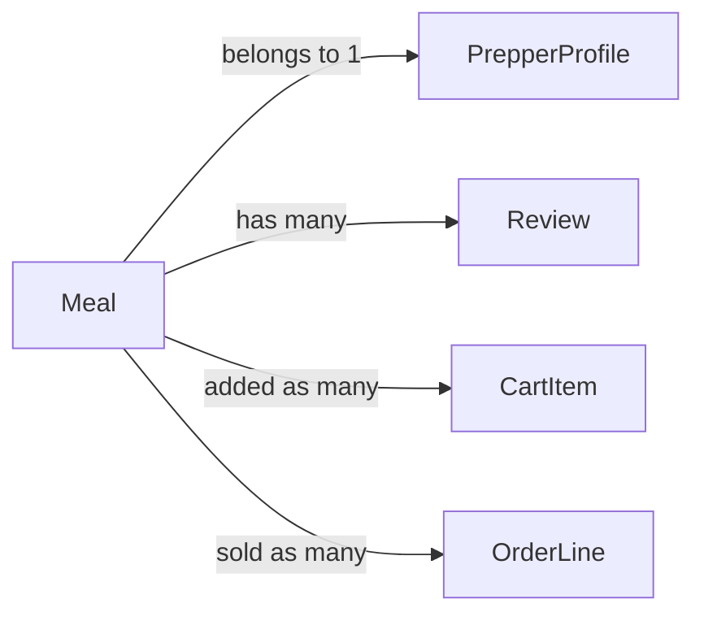

# Meal

## Fields

| Field       | Type          | Key                                         | Rules                             |
| ----------- | ------------- | ------------------------------------------- | --------------------------------- |
| id          | uuid          | PK                                          |                                   |
| prepperId  | uuid          | FK → [PrepperProfile](prepper-profile.md) | taken from the session            |
| name        | text          |                                             | 1–100 characters                  |
| description | text          |                                             | up to 1,000 characters            |
| ingredients | text[]        |                                             | at least 1                        |
| dietaryTags | DietaryTag[]  |                                             |                                   |
| priceCents  | int           |                                             | more than 0                       |
| currency    | text          |                                             | AUD                               |
| imageUrl    | text          |                                             | optional                          |
| status      | MealStatus |                                             | active, hidden, flagged, archived |
| flagReason  | text          |                                             | set by admin                      |
| featuredAt  | timestamptz   |                                             | set by admin; empty = not featured |
| createdAt   | timestamptz   |                                             |                                   |
| updatedAt   | timestamptz   |                                             |                                   |

## Links

- **Does:** shows in browse and on the Prepper page; goes into carts and orders.
- **Checks:** only the owner edits, and not while their profile is `rejected`; only admins flag or unflag; archived meals are never shown or sold; meals of a deactivated Prepper are not shown, added to a cart or reviewed; never hard-deleted.
- **Built in:** 2.4–2.8, 3.6, 7.4
- [Back to data model](../../plan/06-data-model.md)
