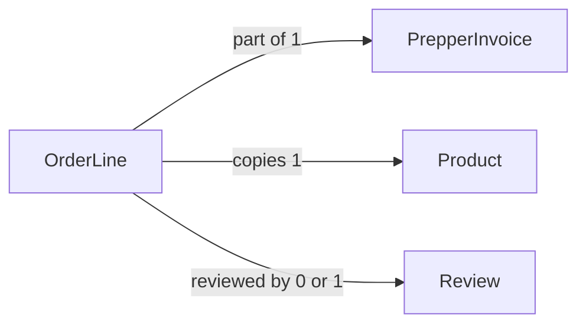

# OrderLine

## Fields

| Field                  | Type | Key                                         | Rules                 |
| ---------------------- | ---- | ------------------------------------------- | --------------------- |
| id                     | uuid | PK                                          |                       |
| invoiceId              | uuid | FK → [PrepperInvoice](prepper-invoice.md) |                       |
| productId              | uuid | FK → [Product](product.md)                  |                       |
| nameSnapshot           | text |                                             | copied at checkout    |
| unitPriceCentsSnapshot | int  |                                             | copied at checkout    |
| quantity               | int  |                                             | 1–20                  |
| lineTotalCents         | int  |                                             | unit price × quantity |

## Links

- **Does:** freezes what was bought and at what price.
- **Checks:** snapshot fields are copied at checkout and never change.
- **Built in:** 5.1
- [Back to data model](../../plan/06-data-model.md)
