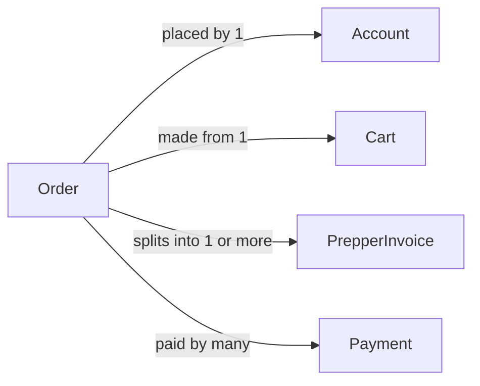

# Order

## Fields

| Field         | Type        | Key                        | Rules                                       |
| ------------- | ----------- | -------------------------- | ------------------------------------------- |
| id            | uuid        | PK                         |                                             |
| buyerId       | uuid        | FK → [Account](account.md) |                                             |
| cartId        | uuid        | FK → [Cart](cart.md), UK   | one order per cart                          |
| status        | OrderStatus |                            | pending_payment, paid, completed, cancelled |
| subtotalCents | int         |                            |                                             |
| totalCents    | int         |                            | same as subtotal                            |
| paidAt        | timestamptz |                            | set by the webhook                          |
| createdAt     | timestamptz |                            |                                             |
| updatedAt     | timestamptz |                            |                                             |

## Links

- **Does:** the buyer's receipt for one checkout.
- **Checks:** totals match the sum of its invoices; only the webhook marks it `paid`; buyers see only their own.
- **Built in:** 5.1, 5.3–5.7
- [Back to data model](../../plan/06-data-model.md)
