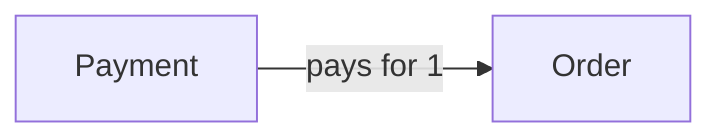

# Payment

## Fields

| Field | Type | Key | Rules |
| --- | --- | --- | --- |
| id | uuid | PK |  |
| orderId | uuid | FK → [Order](order.md) |  |
| stripePaymentIntentId | text | UK |  |
| amountCents | int |  | equals the order total |
| status | PaymentStatus |  | mirrors Stripe |
| lastErrorCode | text |  | optional |
| createdAt | timestamptz |  |  |
| updatedAt | timestamptz |  |  |

## Links

- **Does:** tracks the Stripe payment for an order.
- **Checks:** amount always comes from the order; status changes only from webhook events; one open payment per order.
- **Built in:** 5.3, 5.5
- [Back to data model](../../plan/06-data-model.md)
