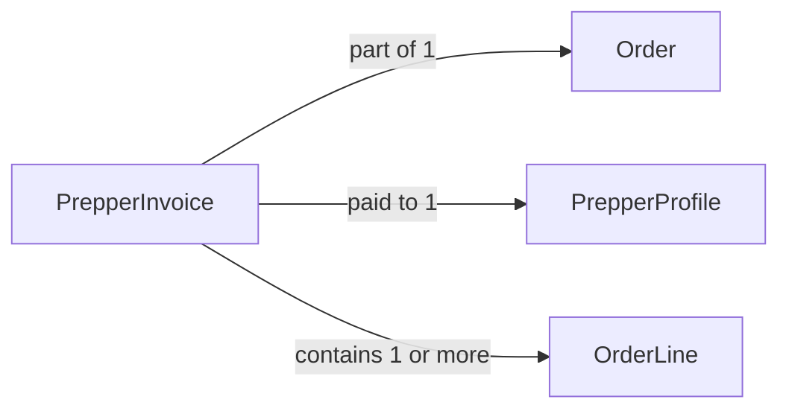

# PrepperInvoice

## Fields

| Field              | Type              | Key                                         | Rules                                         |
| ------------------ | ----------------- | ------------------------------------------- | --------------------------------------------- |
| id                 | uuid              | PK                                          |                                               |
| orderId            | uuid              | FK → [Order](order.md)                      |                                               |
| prepperId         | uuid              | FK → [PrepperProfile](prepper-profile.md) | one invoice per Prepper per order            |
| status             | InvoiceStatus     |                                             | pending_payment, paid, handed_over, cancelled |
| subtotalCents      | int               |                                             |                                               |
| totalCents         | int               |                                             |                                               |
| PrepperPayStatus  | PrepperPayStatus |                                             | pending, paid_out; set by an admin            |
| paidOutAt          | timestamptz       |                                             | optional                                      |
| handedOverAt       | timestamptz       |                                             | optional                                      |
| createdAt          | timestamptz       |                                             |                                               |
| updatedAt          | timestamptz       |                                             |                                               |

## Links

- **Does:** one Prepper's share of an order, with its meals, and whether they've been paid. The payout is the subtotal, paid outside the app.
- **Checks:** one per Prepper per order; only the owning Prepper can mark it `handed_over`, and only once `paid`.
- **Built in:** 5.1, 5.2, 5.5, 5.7, 7.3
- [Back to data model](../../plan/06-data-model.md)
