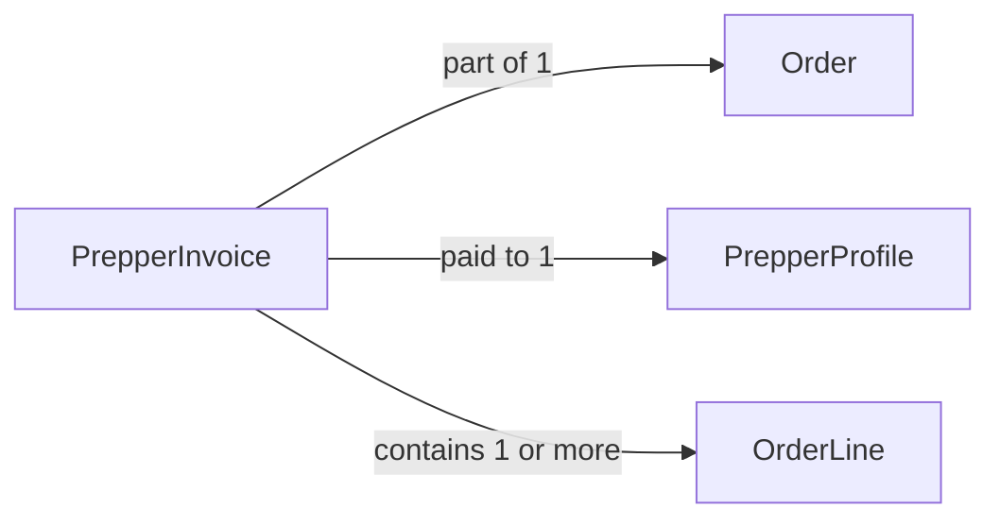

# PrepperInvoice

## Fields

| Field | Type | Key | Rules |
| --- | --- | --- | --- |
| id | uuid | PK |  |
| orderId | uuid | FK → [Order](order.md) |  |
| prepperId | uuid | FK → [PrepperProfile](prepper-profile.md) | one invoice per prepper per order |
| status | InvoiceStatus |  | pending_payment, paid, handed_over, cancelled |
| subtotalCents | int |  |  |
| discountShareCents | int |  | shares add up to the order discount |
| totalCents | int |  |  |
| prepperPayStatus | PrepperPayStatus |  | pending, sent, failed |
| stripeTransferId | text |  | optional |
| handedOverAt | timestamptz |  | optional |
| createdAt | timestamptz |  |  |
| updatedAt | timestamptz |  |  |

## Links

- **Does:** one prepper's share of an order, and their payout.
- **Checks:** one per prepper per order; discount shares add up exactly to the order discount; only the owning prepper can mark it `handed_over`, and only once `paid`.
- **Built in:** 5.1, 5.5, 5.7, 8.1
- [Back to data model](../../plan/06-data-model.md)
