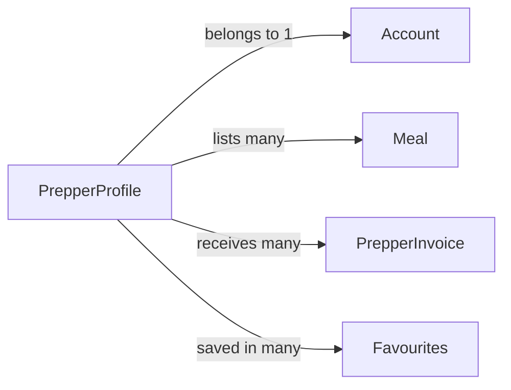

# PrepperProfile

## Fields

| Field            | Type                   | Key                            | Rules                                        |
| ---------------- | ---------------------- | ------------------------------ | -------------------------------------------- |
| accountId        | uuid                   | PK, FK → [Account](account.md) | one profile per account                      |
| displayName      | text                   |                                | 1–60 characters                              |
| street           | text                   |                                |                                              |
| suburb           | text                   |                                |                                              |
| postcode         | text                   |                                | 4 digits                                     |
| state            | AustralianState        |                                |                                              |
| lat              | numeric                |                                | set by geocoding                             |
| lng              | numeric                |                                | set by geocoding                             |
| location         | geography(Point, 4326) |                                | built from lat/lng; GiST index; added in 3.3 |
| cuisineTypes     | CuisineType[]          |                                | at least 1                                   |
| canDeliver       | boolean                |                                |                                              |
| deliveryRadiusKm | int                    |                                | 1–50, only if canDeliver                     |
| foodSafetyStatus | FoodSafetyStatus       |                                | draft to verified                            |
| council          | text                   |                                |                                              |
| licenceNumber    | text                   |                                |                                              |
| licenceExpiry    | date                   |                                | in the future when submitted                 |
| supervisorName   | text                   |                                |                                              |
| supervisorCertNumber | text |                            | typed in; not uploaded                       |
| licenceFilePath  | text                   |                                | private bucket                               |
| createdAt        | timestamptz            |                                |                                              |
| updatedAt        | timestamptz            |                                |                                              |

## Links

- **Does:** lists meals, receives invoices, is paid outside the app.
- **Checks:** one per account; address must geocode; licence expiry in the future; only `verified` Preppers can be bought from.
- **Never sent to the browser:** street, postcode, lat, lng, location, licence fields.
- **Built in:** 2.1, 2.2, 2.3, 2.9, 7.5
- [Back to data model](../../plan/06-data-model.md)
