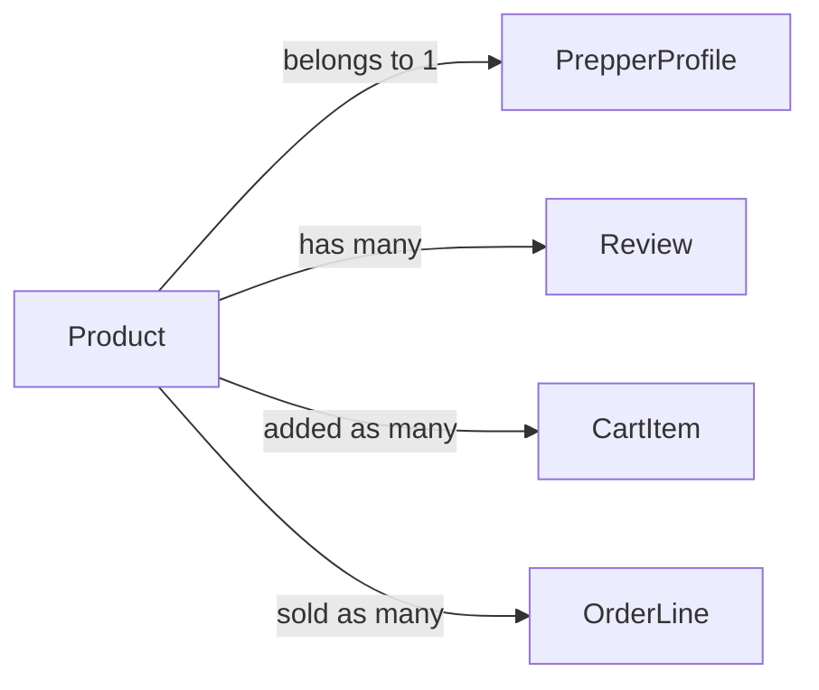

# Product

## Fields

| Field | Type | Key | Rules |
| --- | --- | --- | --- |
| id | uuid | PK |  |
| prepperId | uuid | FK → [PrepperProfile](prepper-profile.md) | taken from the session |
| name | text |  | 1–100 characters |
| description | text |  | up to 1,000 characters |
| ingredients | text[] |  | at least 1 |
| dietaryTags | DietaryTag[] |  |  |
| priceCents | int |  | more than 0 |
| currency | text |  | AUD |
| imageUrl | text |  | optional |
| status | ProductStatus |  | active, hidden, flagged, archived |
| flagReason | text |  | set by admin |
| createdAt | timestamptz |  |  |
| updatedAt | timestamptz |  |  |

## Links

- **Does:** shows in browse and on the prepper page; goes into carts and orders.
- **Checks:** only the owner edits; only admins flag or unflag; archived products are never shown or sold; never hard-deleted.
- **Built in:** 2.4–2.8, 7.4
- [Back to data model](../../plan/06-data-model.md)
