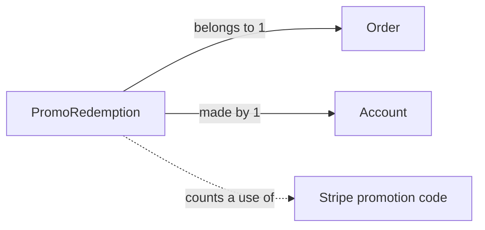

# PromoRedemption

## Fields

| Field | Type | Key | Rules |
| --- | --- | --- | --- |
| id | uuid | PK |  |
| orderId | uuid | FK → [Order](order.md), UK | one per order |
| accountId | uuid | FK → [Account](account.md) |  |
| stripePromotionCodeId | text |  | Stripe's ID for the code |
| code | text |  | the code as the buyer typed it, for receipts and reports |
| discountCents | int |  |  |
| createdAt | timestamptz |  |  |

## Links

- **Does:** records each use of a promo code. Codes themselves live in Stripe.
- **Why we need it:** Stripe doesn't count uses for our own PaymentIntents, so these rows are the use count.
- **Checks:** written only by the webhook after payment succeeds; one per order; the use limit is rechecked under a lock on the Stripe code ID.
- **Built in:** 5.8, 5.9, 7.6
- [Back to data model](../../plan/06-data-model.md)
