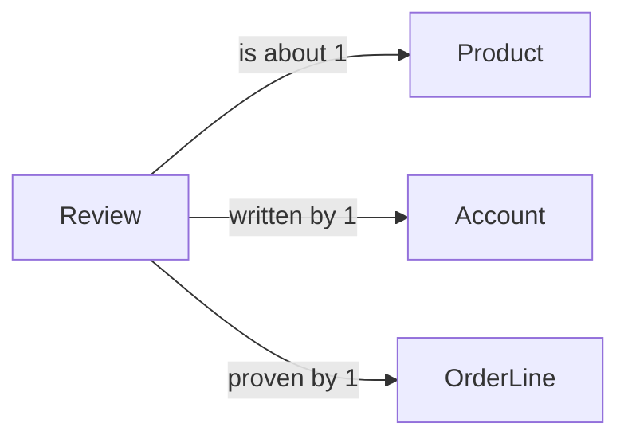

# Review

## Fields

| Field | Type | Key | Rules |
| --- | --- | --- | --- |
| id | uuid | PK |  |
| productId | uuid | FK → [Product](product.md) |  |
| buyerId | uuid | FK → [Account](account.md) | taken from the session |
| orderLineId | uuid | FK → [OrderLine](order-line.md), UK | must be a paid line |
| rating | int |  | 1–5 |
| comment | text |  | 1–1,000 characters |
| createdAt | timestamptz |  |  |
| updatedAt | timestamptz |  |  |

## Links

- **Does:** rates a product the buyer has paid for.
- **Checks:** the order line belongs to the buyer and is paid; one review per buyer per product.
- **Built in:** 6.2
- [Back to data model](../../plan/06-data-model.md)
