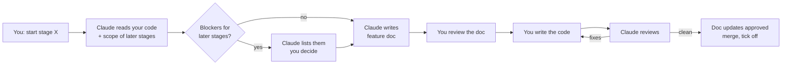

# How we work

## Who does what

- **Rachel** writes all the code.
- **Claude** writes the feature doc for each stage just before it starts, reviews the code, and keeps the docs in sync.
- Docs are written for a person to code from: plain steps, file names, routes, tables, rules and links. No ready-to-paste code beyond short shapes (a route, a type, a SQL clause).

## Stage rules

- One feature per stage.
- Keep the diff under about 300 lines (lockfiles and generated files don't count).
- Build the API first, then the screen that uses it.
- Every stage comes with its tests.
- Never leave `main` broken.
- New ideas found mid-stage become a new stage.

## Each stage, step by step

1. Tell Claude which stage you're starting, e.g. "start 2.4".
2. Claude reads your current code (connected folder or pushed branch) and the scope of every later stage in [Stages](08-stages.md).
3. Claude lists anything in the current code that would block or force rework in a later stage. You decide whether to fix it now, in this stage, or as a new stage.
4. Claude writes the feature doc: `docs/features/<phase>.<n>-<name>.md`, using the [template](../features/_template.md). You review and adjust it.
5. Write the code on a branch: `stage/<phase>.<n>-<name>`, e.g. `stage/3.3-distance-filter`.
6. Ask Claude to review. Any of these work, no commit needed for the first two:
   - point Claude at the repo folder on your computer
   - paste the diff (`git diff main`)
   - push the branch and share the PR link
7. Fix and re-review until it's clean.
8. Approve Claude's doc updates (see [Keeping docs in sync](02-docs-sync.md)).
9. Merge and tick the stage off in [Stages](08-stages.md).

## What the forward check looks for

- Tables or columns a later stage needs that the current shape makes hard to add.
- Names, enums or route shapes that later stages already depend on (from [Data model](06-data-model.md) and [Status changes](07-status-changes.md)).
- Shortcuts that bypass `transition()`, the OpenAPI contract or the single API client.
- Imports across app folders (web and api must stay self-contained).
- Anything that breaks a [business rule](04-business-rules.md) a later stage relies on.

## What every review checks

- The feature doc's **Done** and **Check** lines.
- The [business rules](04-business-rules.md) the stage touches.
- Status changes only go through `transition()`.
- No secrets in code or in the browser.
- Tests cover the happy path and each rule's failure path.
