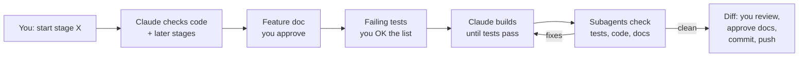

# How we work

## Who does what

- **Claude Code** writes the code, tests and `e2e` scenarios from the approved feature doc, one small step at a time. It also writes each stage's feature doc, reviews its own work through subagents, and keeps the docs in sync.
- **You** set the scope, approve each feature doc and test list, review every diff, approve doc changes, and commit and push. Claude never commits.
- Docs are written for you to review and for Claude to build from: plain steps, file names, routes, tables, rules and links. No ready-to-paste code beyond short shapes (a route, a type, a SQL clause).
- The aim is test-driven, reliable, focused, high-quality output from Claude Code. When something isn't working, change how we work and update this page.

## Stage rules

- One feature per stage.
- Keep the diff under about 300 lines (lockfiles and generated files don't count).
- Tests are written first, from the feature doc. You commit them before the code is built.
- Build the API first, then the screen that uses it.
- Never leave `main` broken. Only you commit and push.
- New ideas found mid-stage become a new stage.

## Each stage, step by step

1. Tell Claude which stage you're starting, e.g. "start 2.4". Bug fixes and adjustments follow the same steps.
2. Claude reads the current code and the scope of every later stage in [Stages](08-stages.md), and lists anything that would block or force rework later. You decide whether to fix it now, in this stage, or as a new stage.
3. Claude writes the feature doc: `docs/features/<phase>.<n>-<name>.md`, using the [template](../features/_template.md). You review and approve it.
4. Claude's `test-writer` writes failing tests from the doc. Claude shows you the test diff and the list of behaviours they cover. You OK them and commit the tests.
5. Claude builds until the tests pass, without committing. Then it runs lint, type-check and the contract check.
6. Claude's subagents check the work: `test-writer` reruns and tidies the tests, while `code-reviewer` and `docs-checker` review in parallel. Claude fixes what they find.
7. Claude presents the uncommitted diff with a summary: what changed, how it was tested, breaking changes and deploy steps, proposed doc changes, and a suggested commit message.
8. You review the diff, ask Claude anything about it, and approve Claude's doc updates (see [Keeping docs in sync](02-docs-sync.md)).
9. You commit, push and tick the stage off in [Stages](08-stages.md).

## What the forward check looks for

- Tables or columns a later stage needs that the current shape makes hard to add.
- Names, enums or route shapes that later stages already depend on (from [Data model](06-data-model.md) and [Status changes](07-status-changes.md)).
- Shortcuts that bypass `transition()`, the OpenAPI contract or the single API client.
- Imports across app folders (web and api must stay self-contained).
- Anything that breaks a [business rule](04-business-rules.md) a later stage relies on.

## What every review checks

- The feature doc's **Done** and **Check** lines.
- The [business rules](04-business-rules.md) the stage touches.
- Status changes only go through `transition()`.
- No secrets in code or in the browser.
- Tests cover the happy path and each rule's failure path.
