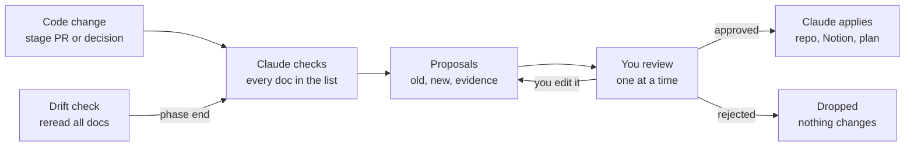

# Keeping docs in sync

Modelled on [Amendary](https://amendary.com/): every doc change comes with proof and waits for your OK.

## Step by step

1. A stage PR or a decision changes something.
2. Claude checks every doc in the list below.
3. For each thing now wrong or missing, Claude writes a proposal: which doc, the old text, the new text, and the proof (PR, commit or decision).
4. You approve, edit or reject each proposal.
5. Claude applies only the approved ones: repo docs go in the same PR; Notion and the Claude build plan are updated through the connectors.
6. At the end of each phase, Claude rereads all docs against `main` and sends any fixes the same way.

## Hard rules

- Nothing is deleted from any doc without your yes.
- Nothing changes in Notion without your yes.
- Docs always read as the current truth. Old text is replaced, never struck through or marked "superseded".
- History lives in git, ADRs and `StatusEvent`, not in the docs themselves.

## The docs

| Doc | Where | Holds |
| --- | --- | --- |
| Notion Prepper page | Notion | Ideas, features, data, scope. **The source of truth.** |
| Build plan | Claude doc + `docs/plan/` | Stages, rules, data model, status changes |
| `CLAUDE.md` | repo root, `web`, `api`, `e2e` | Instructions for Claude: rules, commands, review checklist per app |
| `README.md` | repo root, `web`, `api`, `e2e` | For people: what it is, how to run it, how it's laid out |
| ADRs | `docs/adr/` | One file per big decision: problem, options, choice, consequences |
| Feature docs | `docs/features/` | One file per stage, written when the stage starts: how to build it |
| Entity docs | `docs/data-model/entities/` | One file per table: fields, keys, links, checks |
| Scenario files | `e2e/features/` | Critical paths in plain English; they are tests and docs at once |
