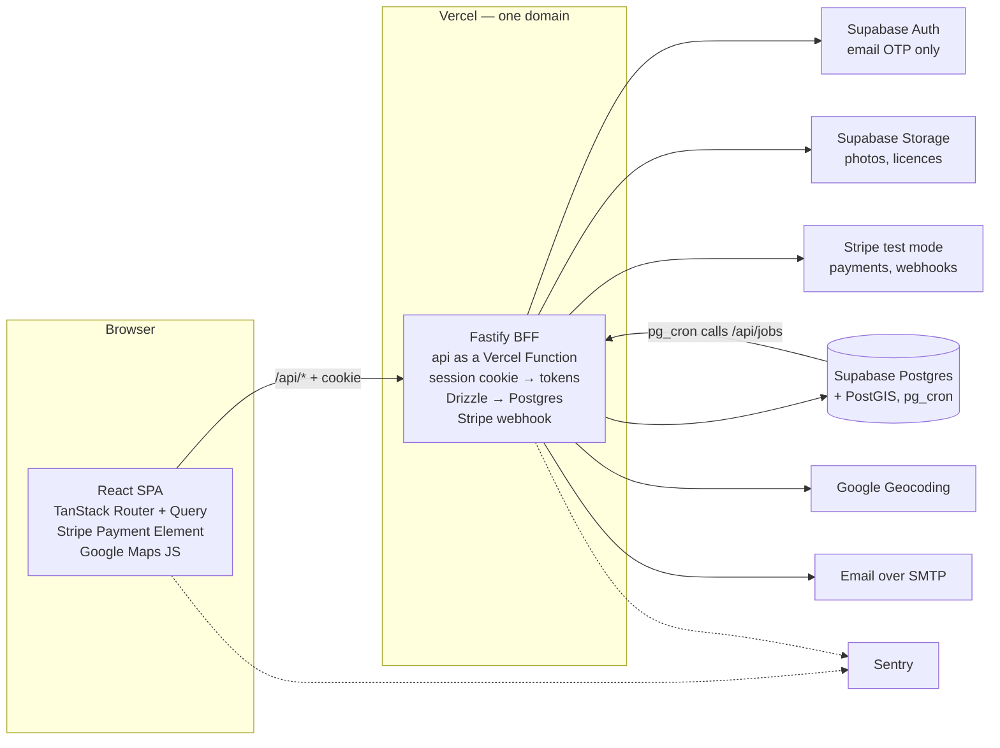
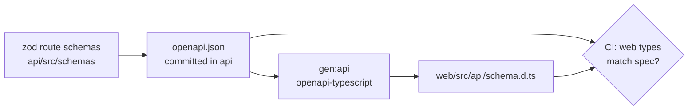

# Architecture

Only the BFF (our Fastify server) holds secrets and talks to outside services. The browser holds a session cookie and public keys only.



## How a request flows

1. The browser sends a request to `/api/...` with only a session cookie.
2. The web project on Vercel forwards `/api/*` to the api project, so the browser sees one site.
3. The BFF checks the cookie (a local token check, no call to Supabase) and looks up the account. Route guards then allow or refuse by role. See [Authentication](15-authentication.md).
4. The BFF calls the database or an outside service with its own secret keys.
5. The BFF returns plain JSON.
6. Errors on either side go to Sentry with the same request ID.

## Tools

| Area            | Choice                                                                                                                         |
| --------------- | ------------------------------------------------------------------------------------------------------------------------------ |
| Repo            | One repo, docs at the root. `web`, `api` and `e2e` are self-contained, each with its own dependencies                          |
| Web             | React, Vite, TypeScript, TanStack Router, Query and Table, React Hook Form + zod, Tailwind CSS + shadcn/ui                                             |
| Server          | Node, Fastify, TypeScript                                                                                                      |
| Database        | Supabase Postgres with Drizzle (migrations in git), PostGIS for distance                                                       |
| Sign-in         | Supabase Auth — email code (OTP) only, called only by the server. No Google or other single sign-on                          |
| Files           | Supabase Storage — public bucket for meal photos, private bucket for licences                                               |
| Payments        | Stripe test mode — Payment Element, one platform account; Preppers are paid outside the app                                   |
| Email           | Sent from an outbox table over SMTP, using a dedicated Gmail account (Resend once you own a domain). Sign-in codes go through the same account via Supabase's SMTP settings |
| Maps            | Google Maps JavaScript API (browser), Geocoding (server)                                                                       |
| Errors and logs | Sentry and pino                                                                                                                |
| Tests           | Vitest, Testing Library, MSW, Fastify `inject`; Playwright + playwright-bdd with video in `e2e` (see [Testing](12-testing.md)) |
| Hosting         | Vercel — two projects from this repo (`web`, `api`); Supabase cloud                                                            |
| Wireframes      | Start from [Screens](14-screens.md); refine in Claude design or Miro just before each screen stage                              |

## Repo layout

```text
preppers/
├── CLAUDE.md            agent memory: rules, commands, review checklist
├── README.md
├── docs/
│   ├── plan/            this build plan, one file per section
│   ├── features/        one file per phase: how each stage is built
│   ├── data-model/      one file per table
│   └── adr/             decision records
├── web/                 React SPA → Vercel project "preppers-web"
├── api/                 Fastify BFF → Vercel project "preppers-api"
└── e2e/                 Playwright critical-path tests with video
```

- Each Vercel project sets its Root Directory to its app folder.
- No Vercel project uses the repo root. That matters because Vercel treats a root-level `api/` folder as serverless functions; with Root Directory set to `web` or `api`, it never sees the repo root.
- Each app has its own `package.json`, lockfile, `node_modules`, tsconfig, lint and test setup. No app imports from another.
- The root holds docs that span the whole product, plus `CLAUDE.md`. No root `package.json`.
- Each Vercel project only rebuilds when files in its own folder change (Ignored Build Step: `git diff --quiet HEAD^ HEAD -- .`).

## The contract between web and api

With no shared code, the API's OpenAPI spec keeps both sides in step.



1. The API declares a zod schema for every route's params, body and response.
2. `pnpm openapi` in `api` writes `openapi.json` from those schemas. It's committed.
3. `pnpm gen:api` in `web` reads that file and writes `src/api/schema.d.ts`.
4. CI regenerates both and fails if either is out of date, so a route change can't silently break the web app.
5. Enums the web app shows (dietary tags, statuses) come through the generated types. Display labels live in the web app.

- Root docs sit outside both apps, so they never deploy. Still never put secrets in them.

## Free tiers

Every tool has a free tier that fits a hobby project. Google Maps is the only one that needs a card.

- **Vercel Hobby** — hosts the web app and the Fastify server. Personal, non-commercial use only. Hard limits, so no surprise bills. ([Vercel](https://vercel.com/docs/plans/hobby))
- **Fastify on Vercel** — Vercel detects Fastify and runs the whole app as one function. ([Vercel](https://vercel.com/docs/frameworks/backend/fastify))
- **Supabase free** — 2 projects, 500 MB database, 1 GB files. Pauses after 7 days of no activity; can be restored for 90 days. ([Supabase](https://supabase.com/docs/guides/platform/free-project-pausing))
- **Stripe** — test mode is free.
- **Gmail SMTP** — free with a dedicated Gmail account and an app password. Daily send cap applies (check Google's current limit). **Resend free** is the upgrade: 3,000 emails a month, up to 100 a day, needs a domain you own. ([Resend](https://resend.com/pricing))
- **Sentry Developer** — free for 1 user, 5,000 errors a month.
- **Google Maps** — 10,000 free calls a month for each Essentials product, such as Geocoding. ([Google](https://developers.google.com/maps/billing-and-pricing/pricing-categories))
- **GitHub Actions** — free CI minutes are plenty for one developer.
- **Backup host:** Google Cloud Run — always free up to 2 million requests a month; needs a card.
- **Not used:** Render (sleeps after 15 minutes idle), Fly.io (no free tier for new accounts), Railway ($1 of credit a month after trial).
- **Only likely cost:** none for now. A domain name is only needed to move email from Gmail to Resend.

## What running as a function means

1. No long sleeps: the function starts in moments when a request arrives.
2. Nothing is kept in memory between requests, so rate-limit counts live in the database.
3. No background workers. Scheduled jobs run in Supabase `pg_cron`, which calls a protected `/api/jobs/*` route when the server needs to act.
4. Stripe webhooks need the raw request body; register the raw-body parser on that route only.
5. A weekly GitHub Actions ping stops Supabase from pausing.

## Staying secure on free tiers

- Turn on two-factor sign-in for GitHub, Vercel, Supabase, Stripe, Google Cloud, the dedicated Gmail account and Sentry.
- Keep secrets in each host's settings, never in the repo or the browser.
- Turn on row-level security for every table, with no policies; the service key lives only on the server.
- Turn off the Supabase Data API, since every query goes through Drizzle on the server.
- Lock the Google browser key to your domain and the Maps JavaScript API; lock the server key to Geocoding.
- Set a Google daily quota and budget alert, so a leaked key can't run up a bill.
- Use Stripe test keys only, and check the signature on every webhook.
- Protect `/api/jobs/*` with a secret that only `pg_cron` knows.
- Sign-in limits (stage 1.2), and checkout limits and security headers (stage 8.3), matter more here, because there's no paid firewall in front.
- Vercel's Hobby terms let it use deployed content for AI training. Keep secrets in environment settings and never put user data in the code.
