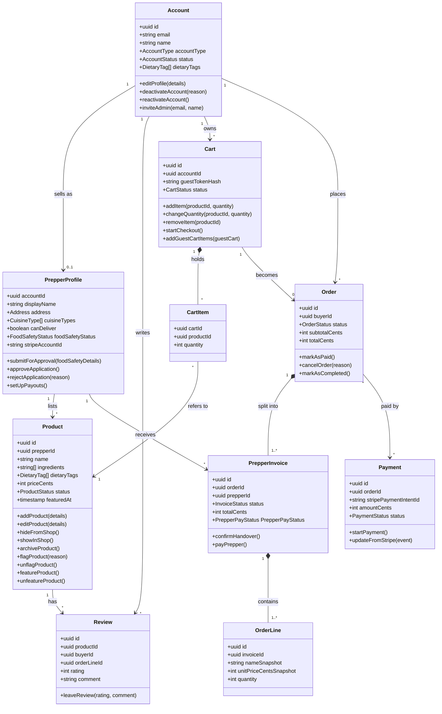

# Class diagram

**How to read it**

1. Each box is one class: its fields on top, its actions underneath.
2. Each action is an API route or a step the server runs. Any action that changes a status goes through `transition()`.
3. A plain arrow means "refers to". A filled diamond means "is part of": the child can't exist without its parent.
4. Numbers on the lines show how many: `1`, `0..1` (none or one), `*` (any number), `1..*` (at least one).
5. Log tables (`StripeEvent`, `StatusEvent`, `EmailOutbox`, `AuditLog`, `PlaceLookup`) are left out to keep it readable. Full fields, types and keys are in the [entity docs](../data-model/entities/).

## What each action does

| Class           | Action                                      | Who does it                                 | What happens                                                                                                              |
| --------------- | ------------------------------------------- | ------------------------------------------- | ------------------------------------------------------------------------------------------------------------------------- |
| Account         | `editProfile`                               | the person                                  | Changes their name, suburb or dietary needs.                                                                              |
| Account         | `deactivateAccount`                         | admin                                       | Blocks sign-in and takes their meals off browse, with a reason. Buyer and Prepper accounts only, never an admin account. |
| Account         | `reactivateAccount`                         | admin                                       | Lifts the deactivation.                                                                                                   |
| Account         | `inviteAdmin`                               | admin                                       | Creates an admin account for an email that has no account yet. They then sign in with the email code. |
| PrepperProfile | `submitForApproval`                         | Prepper                                     | Sends their food safety details and licence for an admin to check.                                                        |
| PrepperProfile | `approveApplication`                           | admin                                       | The Prepper can now sell, and appears in browse.                                                                         |
| PrepperProfile  | `rejectApplication`                         | admin                                       | Turns down an application with a reason (`rejected`) and emails the Prepper, who can fix the details and send it again. |
| PrepperProfile | `setUpPayouts`                              | Prepper                                     | Opens Stripe's hosted sign-up so they can be paid.                                                                        |
| Product         | `addProduct` / `editProduct`                | Prepper                                     | Creates or changes a meal.                                                                                                |
| Product         | `hideFromShop` / `showInShop`               | Prepper                                     | Takes a meal off browse for a while, or puts it back.                                                                     |
| Product         | `archiveProduct`                            | Prepper                                     | Retires a meal for good. Old receipts still show it.                                                                      |
| Product         | `flagProduct` / `unflagProduct`             | admin                                       | Pulls a meal from browse with a reason, or clears the flag.                                                               |
| Product         | `featureProduct` / `unfeatureProduct`       | admin                                       | Puts an active meal on the home page (sets `featuredAt`), or takes it off.                                                |
| Review          | `leaveReview`                               | buyer                                       | Rates a meal from an order line whose invoice is `paid` or `handed_over`. One review per order line.                                                                                         |
| Cart            | `addItem` / `changeQuantity` / `removeItem` | buyer or guest                              | Edits what's in the cart.                                                                                                 |
| Cart            | `startCheckout`                             | buyer                                       | Locks the cart, creates the order and its invoices, then calls `startPayment`.                                            |
| Cart            | `addGuestCartItems`                         | the server, on sign-in                      | Moves items from the guest cart into the account's cart (same meal → quantities add up). The guest cart becomes `merged`. |
| Order           | `markAsPaid`                                | the server, when Stripe confirms            | The order and its invoices become `paid`.                                                                                 |
| Order           | `cancelOrder`                               | the server                                  | Cancels an unpaid order: cart edited, payment failed for good, or 24 hours passed.                                        |
| Order           | `markAsCompleted`                           | the server                                  | Runs when the last invoice is handed over.                                                                                |
| PrepperInvoice  | `confirmHandover`                           | Prepper                                     | The Prepper confirms the buyer has received their meals (picked up or delivered). Only possible once the invoice is `paid`. No money moves here; the payout is `payPrepper`. |
| PrepperInvoice | `payPrepper`                               | the server                                  | Sends the Prepper's share from our Stripe balance to their Stripe account (a Stripe "transfer"). Retried if it fails.    |
| Payment         | `startPayment`                              | the server, from `startCheckout` or a retry | Creates the Stripe PaymentIntent and gives the browser its client secret, so the Payment Element can take the card.       |
| Payment         | `updateFromStripe`                          | the webhook                                 | Stripe tells us the result (succeeded, declined, needs 3DS). We copy the status and, on success, call `markAsPaid`.       |

## Status enums

Values are stored in the database as written.

| Enum                           | Value                     | Means                                                 |
| ------------------------------ | ------------------------- | ----------------------------------------------------- |
| AccountType                    | `buyer`                   | Can buy. Can also sell once they have a Prepper profile. |
|                                | `admin`                   | Runs the site. Can't buy, sell or review.             |
| AccountStatus                  | `active`                  | Can sign in and use the site.                         |
|                                | `deactivated`             | Blocked by an admin. Only an admin can reactivate it.|
| FoodSafetyStatus               | `draft`                   | Prepper is still filling in their details.           |
|                                | `pending_review`          | Sent for approval; waiting on an admin.               |
|                                | `verified`                | Approved. Can sell.                                   |
|                                | `rejected`                | Sent back with a reason. Can resubmit.                |
|                                | `expired`                 | Their licence date has passed. Must resubmit.         |
| ProductStatus                  | `active`                  | Shows in browse and can be bought.                    |
|                                | `hidden`                  | Taken off browse by the Prepper.                     |
|                                | `flagged`                 | Taken off browse by an admin.                         |
|                                | `archived`                | Retired for good.                                     |
| CartStatus                     | `active`                  | Being filled.                                         |
|                                | `checking_out`            | Locked while the buyer pays.                          |
|                                | `ordered`                 | Paid; it became an order.                             |
|                                | `merged`                  | A guest cart moved into an account cart on sign-in.   |
|                                | `abandoned`               | A guest cart untouched for 1 hour; cleared by a job. |
| OrderStatus                    | `pending_payment`         | Created; waiting for Stripe to confirm payment.       |
|                                | `paid`                    | Stripe confirmed payment.                             |
|                                | `completed`               | Every Prepper has handed over their meals.           |
|                                | `cancelled`               | Never paid.                                           |
| InvoiceStatus                  | `pending_payment`         | Part of an order that isn't paid yet.                 |
|                                | `paid`                    | Paid; the Prepper should prepare the meals.          |
|                                | `handed_over`             | The Prepper confirmed the buyer has the meals.       |
|                                | `cancelled`               | The order was cancelled.                              |
| PrepperPayStatus              | `pending`                 | The Prepper's share hasn't been sent yet.            |
|                                | `sent`                    | Sent to the Prepper's Stripe account.                |
|                                | `failed`                  | Sending failed. A job retries it.                     |
| PaymentStatus                  | `requires_payment_method` | Waiting for card details, or the card was declined.   |
| (Stripe's own names)           | `requires_action`         | The bank wants an extra check (3DS).                  |
|                                | `processing`              | Stripe is working on it.                              |
|                                | `succeeded`               | Money taken.                                          |
|                                | `canceled`                | Payment stopped. Stripe spells it with one "l".       |
| ActorType                      | `account`                 | A person made the change.                             |
|                                | `system`                  | A scheduled job made the change.                      |
|                                | `stripe`                  | A Stripe webhook made the change.                     |

Status moves are drawn in [Status changes](07-status-changes.md).
