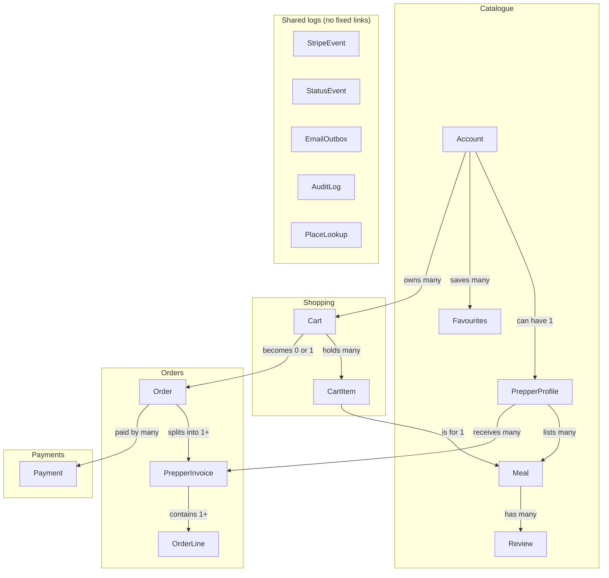

# Data model

Every order splits into one invoice per Prepper.

## Reading it, top to bottom

1. An account may have one Prepper profile. A Prepper has many meals, and meals have reviews.
2. An account has carts, and a cart holds items. Favourites link accounts to Preppers and meals.
3. Checking out a cart creates one order. The order splits into one invoice per Prepper, each with its own lines.
4. An order has one or more payment attempts.
5. The log tables at the bottom are shared by every flow.

## General rules

- Money is stored as whole cents (`int`), in AUD.
- Date and time: Postgres `timestamptz` (stored as UTC). The API sends ISO 8601 UTC strings, e.g. `2026-10-10T03:41:16.000Z`. The web app shows `Australia/Brisbane` time. Never use `timestamp` without a time zone.
- Date only (e.g. `licenceExpiry`): Postgres `date`, sent as `YYYY-MM-DD`.
- Every table has `id` (uuid), `createdAt` and `updatedAt` unless noted.
- Table names in Postgres are `snake_case` plurals (`prepper_profiles`); columns are `snake_case`; Drizzle maps them to `camelCase`.
- Order lines copy the meal name and price at purchase, so receipts never change.

## Common types

Defined in the API's zod schemas and passed to the web app through the OpenAPI contract.

- `DietaryTag` — vegetarian, vegan, gluten_free, dairy_free, nut_free, halal, kosher, low_carb
- `CuisineType` — lives in the `api` zod schemas (`web` gets it through the generated OpenAPI types); fixed list, e.g. australian, chinese, indian, italian, japanese, korean, mexican, middle_eastern, thai, vietnamese, other
- `AustralianState` — QLD, NSW, VIC, TAS, SA, WA, NT, ACT
- Status enums — see [Status changes](07-status-changes.md)

## Tables

Each name opens its entity doc: fields, types, keys, links and checks.

- **Catalogue**
  - [Account](../data-model/entities/account.md) — one per person; admin flag, status, dietary needs
  - [PrepperProfile](../data-model/entities/prepper-profile.md) — selling details, location, food safety
  - [Meal](../data-model/entities/meal.md) — a meal for sale
  - [Review](../data-model/entities/review.md) — a buyer's rating of a meal they paid for
  - [Favourites](../data-model/entities/favourites.md) — saved Preppers and meals
- **Shopping**
  - [Cart](../data-model/entities/cart.md) — for an account or a guest
  - [CartItem](../data-model/entities/cart-item.md) — a meal and quantity in a cart
- **Orders**
  - [Order](../data-model/entities/order.md) — the buyer's receipt
  - [PrepperInvoice](../data-model/entities/prepper-invoice.md) — one Prepper's share of an order
  - [OrderLine](../data-model/entities/order-line.md) — name and price frozen at purchase
- **Payments and logs**
  - [Payment](../data-model/entities/payment.md) — the Stripe payment for an order
  - [StripeEvent](../data-model/entities/stripe-event.md) — webhooks already handled
  - [StatusEvent](../data-model/entities/status-event.md) — history of every status change
  - [EmailOutbox](../data-model/entities/email-outbox.md) — emails waiting to send
  - [AuditLog](../data-model/entities/audit-log.md) — admin edits
  - [PlaceLookup](../data-model/entities/place-lookup.md) — cached suburb and postcode positions
