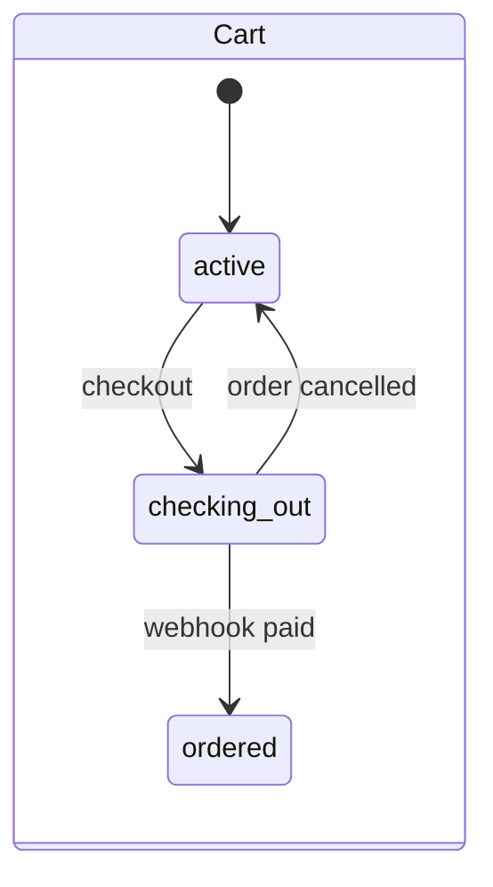
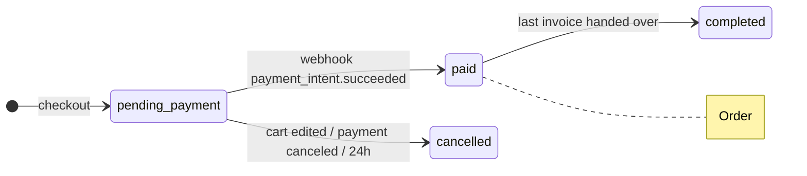
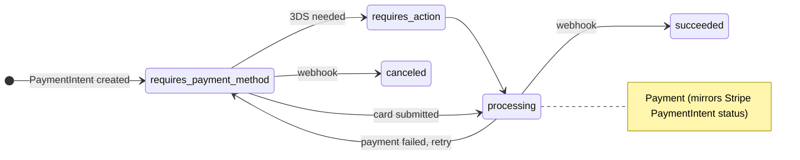
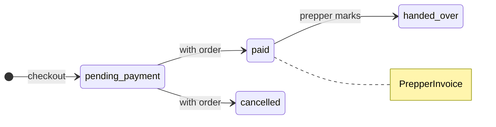
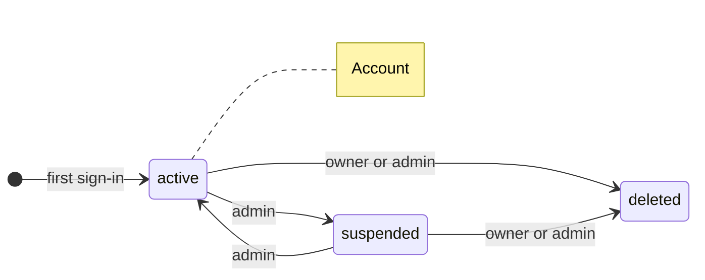
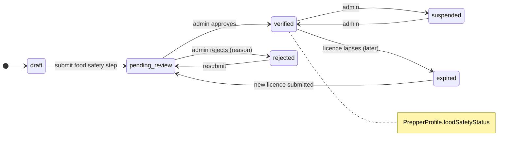
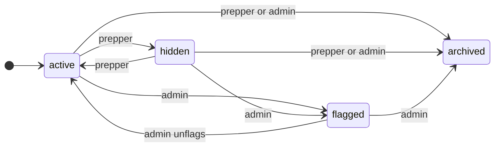

# Status changes

## Rules for every status

- Allowed moves for each entity live in one map in `api/src/services/status.ts`. The web app gets the status values through the OpenAPI contract.
- One function, `transition(tx, entity, id, to, actor, reason?)`, makes every change and returns 409 for a move not on the map.
- Each change also writes a `StatusEvent` row in the same database transaction.
- Only Stripe's webhook can say money was received. The browser can't.

## Checkout

One Stripe webhook moves cart, order, payment and invoices together.

### Step by step

1. The buyer fills a cart. The cart is `active`.
2. The buyer checks out. The cart becomes `checking_out`. An order and one invoice per prepper are created as `pending_payment`, and a Stripe payment starts.
3. The buyer pays. 3DS checks and failed attempts move the payment between `requires_action`, `processing` and `requires_payment_method`; the order stays `pending_payment`.
4. Stripe's webhook confirms payment. In one transaction: payment becomes `succeeded`, the order and invoices become `paid`, the cart becomes `ordered`, and each prepper's pay is queued.
5. Each prepper marks their invoice `handed_over` once the buyer has the meals.
6. When the last invoice is handed over, the order becomes `completed`.

### If it goes wrong

- The buyer edits the cart during checkout: the order and invoices are `cancelled`, and the cart goes back to `active`.
- The payment is cancelled: the same as above.
- The order is still unpaid after 24 hours: a scheduled job cancels it.
- Paying a prepper fails: `prepperPayStatus` becomes `failed`; a scheduled job retries it.

## Accounts and prepper checks

A prepper sells only while verified.

### Account, step by step

1. Created as `active` the first time someone signs in.
2. An admin can suspend it and later reinstate it. Suspended accounts can't sign in.
3. The owner or an admin can delete it. Personal details are wiped. This can't be undone.

### Prepper check, step by step

1. A new prepper starts in `draft`.
2. Submitting the food safety step moves them to `pending_review`.
3. An admin approves (`verified`) or rejects with a reason (`rejected`).
4. A rejected prepper can fix and resubmit.
5. Only `verified` preppers show in browse and can be bought from.
6. An admin can suspend a verified prepper. Later, licences that run out will move to `expired`.

## Products

- `archived` is permanent; ordered products are never truly deleted.

## Guest carts

- Guest cart → `merged` when the guest signs in.
- Guest cart → `abandoned` after 30 days untouched.

## Allowed-move map

| Entity | From → To | Actor |
| --- | --- | --- |
| Account | active ↔ suspended | admin |
| Account | active, suspended → deleted | owner, admin |
| PrepperProfile | draft, rejected, expired → pending_review | prepper |
| PrepperProfile | pending_review → verified, rejected | admin |
| PrepperProfile | verified ↔ suspended | admin |
| PrepperProfile | verified → expired | system |
| Product | active ↔ hidden | prepper |
| Product | active, hidden → flagged; flagged → active | admin |
| Product | any → archived | prepper (not from flagged), admin |
| Cart | active → checking_out | buyer |
| Cart | checking_out → active | system |
| Cart | checking_out → ordered | stripe |
| Cart | active → merged, abandoned | system |
| Order | pending_payment → paid | stripe |
| Order | pending_payment → cancelled | buyer, stripe, system |
| Order | paid → completed | system |
| PrepperInvoice | pending_payment → paid | stripe |
| PrepperInvoice | pending_payment → cancelled | system |
| PrepperInvoice | paid → handed_over | prepper |
| Payment | any Stripe status → its new Stripe status | stripe |
