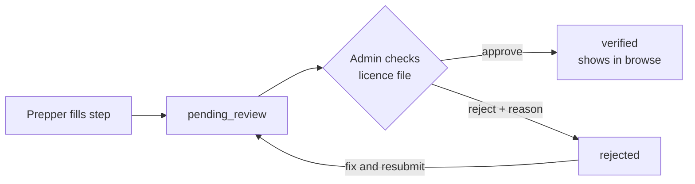

# Food safety checks

Preppers add a food safety step at sign-up. An admin approves it before they appear in browse or can be bought from.

## Why

- In Queensland, home-based meal businesses generally need a council food licence and a named Food Safety Supervisor ([ABLIS](https://ablis.business.gov.au/service/qld/food-business-licence-goondiwindi-/5499), [Somerset council](https://www.somerset.qld.gov.au/environmental-health/food/8)).
- Other states have different rules. Check with councils before launch. This isn't legal advice.

## What the sign-up step asks for

- State and council
- Licence or registration number
- Licence expiry date (must be in the future)
- Food Safety Supervisor name and certificate
- Licence file (PDF, JPEG or PNG; stored in a private bucket)
- A tick-box declaring the details are true

## How it works, step by step

1. The prepper fills in the step and moves to `pending_review` (stage 2.9).
2. They can keep adding products while they wait.
3. An admin checks the licence file in the queue (stage 7.5). This is manual; there's no national licence lookup.
4. The admin approves or rejects with a reason. The prepper gets an email either way.
5. Approved preppers show in browse and can be bought from (once Stripe payouts are on too).
6. Later: an automatic reminder before the licence runs out, and an `expired` status after it does.

## For development

- Seed preppers as `verified`, so phases 3–6 don't wait for stage 7.5.
