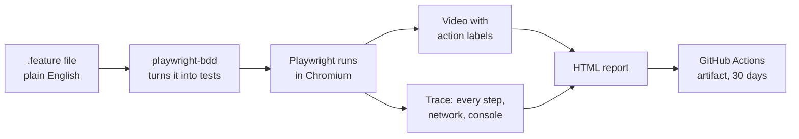

# Testing

Every critical path is written as a plain-English scenario, run in a real browser, and recorded as a video. The scenarios are the documentation.

## Test layers

| Layer          | Where | Tools                                                    | Runs                         |
| -------------- | ----- | -------------------------------------------------------- | ---------------------------- |
| API            | `api` | Vitest + Fastify `inject`, local Supabase                | every PR touching `api`      |
| Web            | `web` | Vitest + Testing Library + MSW                           | every PR touching `web`      |
| Contract       | both  | regenerate `openapi.json` and web types; fail if changed | every PR                     |
| Critical paths | `e2e` | Playwright + playwright-bdd, video on                    | every PR                     |
| Release paths  | `e2e` | same, tagged `@release`                                  | nightly and before a release |

All free: open-source tools plus GitHub Actions minutes.

## How a critical-path run works



1. You write the scenario in a `.feature` file: Given / When / Then, in plain English.
2. playwright-bdd turns each scenario into a Playwright test, using step code in `e2e/steps/`.
3. Playwright runs it in Chromium against the web app and API.
4. Each critical-path run records a video. Each click and typed value is labelled on screen, with the scenario name in the corner.
5. Playwright also saves a trace, which you can step through action by action with the network calls and console at that moment.
6. The HTML report holds the videos and traces. GitHub Actions keeps it as a download for 30 days. Open it with `pnpm exec playwright show-report <folder>`.

## Video settings

- `@critical` scenarios: video **on** for every run, with action and test labels.
- All other scenarios: video **only when a test fails**.
- Viewport 1280×720, so videos are readable.
- Traces: kept on failure, and always for `@critical`.

## Example scenario

```gherkin
@critical
Feature: Check out a cart from two Preppers

  Scenario: Buyer pays once and gets one receipt
    Given I am signed in as a buyer
    And my cart has "Beef rendang" from "Siti's Kitchen"
    And my cart has "Veggie lasagne" from "Nonna Rosa"
    When I check out and pay with the test card "4242 4242 4242 4242"
    Then I see a receipt with 2 Preppers
    And the order status is "paid"
```

## Critical paths (every PR, with video)

| #   | Path                                                                                            | Scenario file                   | Added in stage |
| --- | ----------------------------------------------------------------------------------------------- | ------------------------------- | -------------- |
| C1  | Sign in with an email code, see your name, sign out, can't reach account pages                  | `sign-in-out.feature`           | 1.6            |
| C2  | Guest adds meals, signs in, cart is still there                                                 | `guest-cart-merge.feature`      | 4.3            |
| C3  | Buyer checks out meals from two Preppers with a test card, sees one receipt grouped by Prepper | `checkout-two-preppers.feature` | 5.6            |
| C4  | Prepper marks their invoice handed over; the buyer's order shows completed                     | `hand-over-order.feature`       | 5.7            |
| C5  | New Prepper signs up with the food safety step; admin approves; Prepper appears in browse     | `prepper-approved.feature`     | 7.6            |

## Release paths (nightly, video on failure)

| #   | Path                                                                       | Added in stage |
| --- | -------------------------------------------------------------------------- | -------------- |
| R1  | Guest browses and filters by cuisine and dietary needs                     | 3.2            |
| R2  | Search near a suburb or postcode; "delivers to me" filter                  | 3.3            |
| R3  | Prepper adds a meal with a photo, hides it, archives it; it leaves browse | 2.8            |
| R4  | Checkout with a 3DS test card                                              | 5.4            |
| R5  | Declined card, then a retry that succeeds                                  | 5.5            |
| R6  | Editing the cart mid-checkout cancels the pending order                    | 5.5            |
| R7  | Buyer reviews a meal they bought; can't review one they didn't             | 6.2            |
| R8  | Admin flags a meal; it disappears from browse                              | 7.6            |
| R9  | Admin deactivates an account; that person can't sign in                    | 7.6            |

## Handling the tricky parts

- **Email code sign-in:** steps read the code from local Supabase's test inbox through its API. No real email.
- **Stripe:** use test cards in the Payment Element (it's in an iframe; use Playwright's frame locator). Forward webhooks with the Stripe CLI. Wait for the order to show `paid` before checking the receipt.
- **Test data:** each scenario creates its own accounts and meals through seed helpers, so scenarios can run in any order.
- **Finding elements:** by role and label first (`getByRole`, `getByLabel`). `data-testid` only when nothing else works.
- **Fixed time:** set the browser clock for scenarios that depend on time.

## In CI

1. Start local Supabase (Docker) and seed it.
2. Start the API and web app.
3. Start the Stripe CLI webhook forwarder with the test secret key from GitHub secrets.
4. Run `@critical` on every PR, and everything on the nightly schedule.
5. Upload the HTML report as an artifact.

## Keep reports private

Traces and videos can show cookies, emails and tokens. Keep them as private GitHub Actions artifacts. Don't publish reports to a public site. GitHub Pages from a private repo needs a paid GitHub plan, so download the report instead.

## Docs

- [Playwright videos](https://playwright.dev/docs/videos)
- [Playwright trace viewer](https://playwright.dev/docs/trace-viewer)
- [Playwright in CI](https://playwright.dev/docs/ci-intro)
- [playwright-bdd](https://vitalets.github.io/playwright-bdd/)
- [Stripe test cards](https://docs.stripe.com/testing)
- [Supabase local development](https://supabase.com/docs/guides/local-development)
