# Screens

Wireframes for every screen. The drawings are kept in the [build plan doc](https://claude.ai/code/artifact/7e4142cf-4e8b-4b3a-ad72-112b782662c1), where you can comment on them; the images here are copies.

Fifteen wireframes cover every screen in the build, grouped by who uses them.

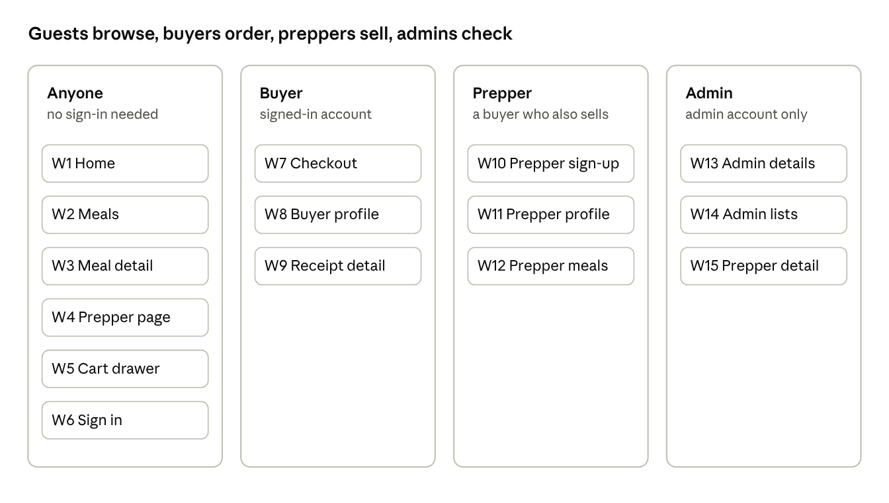

**How to read the wireframes**

- Grey bars stand for text. Boxes with a cross stand for photos.
- The coloured button is the main action on that screen.
- Numbered dots match the numbered notes under each wireframe.
- Names, prices and dates are made up, just to show the layout.
- A prepper is a buyer with a prepper profile, so preppers see the buyer screens too.
- Some screens need small plan changes. They are listed at the end of this section for your OK.

## W1 Home

The home page gets buyers to meals near them in one step.

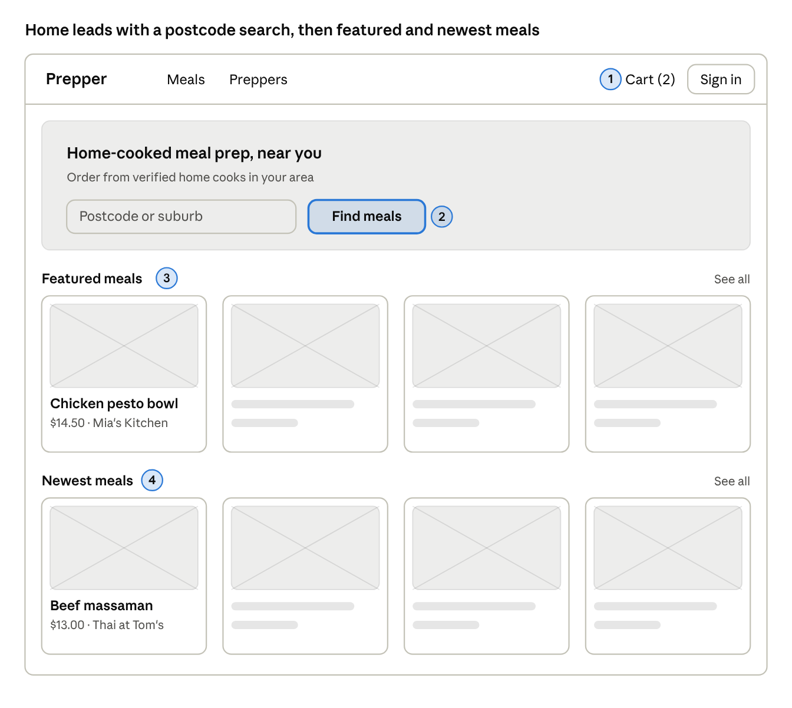

1. **Header** (on every page): Meals, Preppers, cart count, Sign in. The cart opens the cart drawer (W5). Once signed in, Sign in becomes the account menu.
2. **Postcode search** opens Meals (W2) with the location filter set and kept in the URL.
3. **Featured meals**: up to 4 meals an admin has picked (plan change 1). See all opens Meals filtered to featured.
4. **Newest meals**: the 4 most recently added meals. See all opens Meals sorted by newest.

Both rows only show active meals from verified preppers with payouts on.

## W2 Meals

Every buyable meal in one list, filtered and paged on the server.

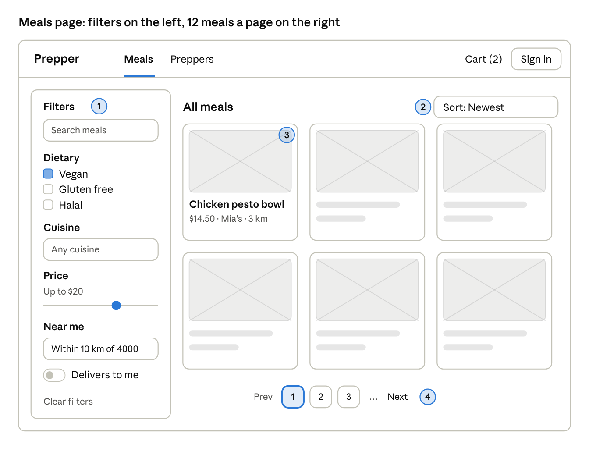

1. **Filters**: search, dietary tags, cuisine, max price, distance from a postcode, and "delivers to me". Every filter lives in the URL, so links and the back button work.
2. **Sort**: newest (default), price, or distance (only once a postcode is set).
3. **Meal card**: photo, name, price, prepper, distance rounded to the km. Opens Meal detail (W3). The heart saves a favourite once signed in.
4. **Pages** of 12. Changing a filter goes back to page 1.

- No results shows "No meals match" and a Clear filters button.
- Needs a meals list API next to the prepper list (plan change 2).

## W3 Meal detail

One meal, with everything a buyer needs before tapping Add to cart.

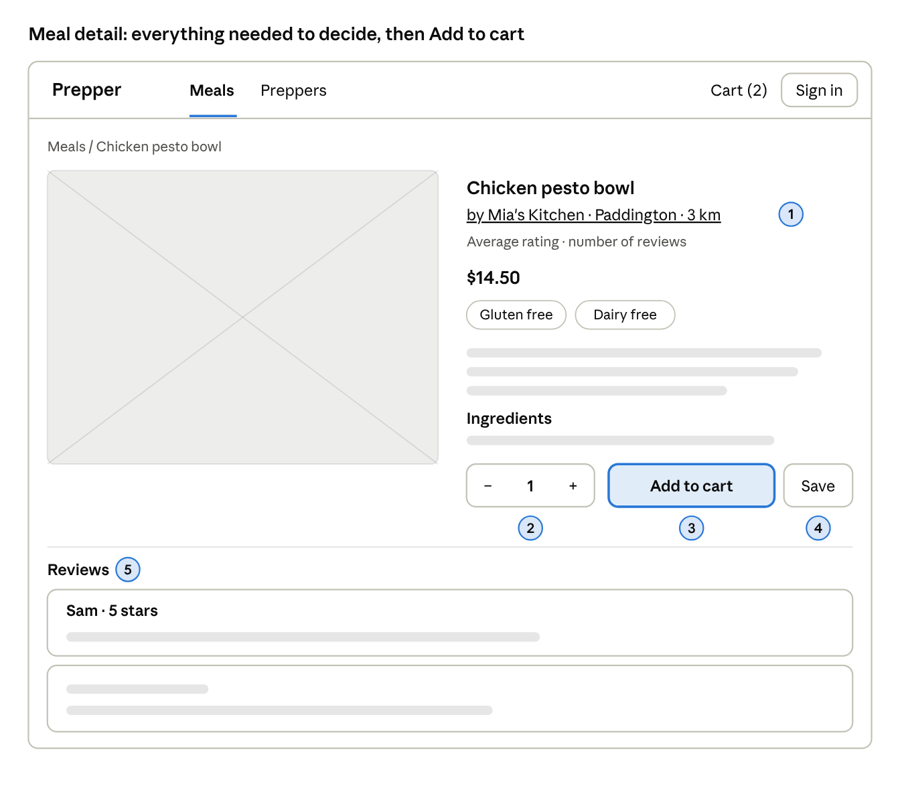

1. **Prepper link** opens the Prepper page (W4). Distance is rounded to the km.
2. **Quantity** goes from 1 to 20.
3. **Add to cart** adds the meal and opens the cart drawer (W5). Guests can add too.
4. **Save** adds a favourite. Guests are sent to Sign in (W6) first, then back here.
5. **Reviews**, newest first, from buyers who bought this meal.

When the meal can't be bought (hidden, flagged, archived, or the prepper isn't verified with payouts on), the page shows "Not available right now" instead of the buttons. An old receipt link still opens it.

## W4 Prepper page

One prepper's public page: who they are, roughly where, and what they sell (stage 3.4).

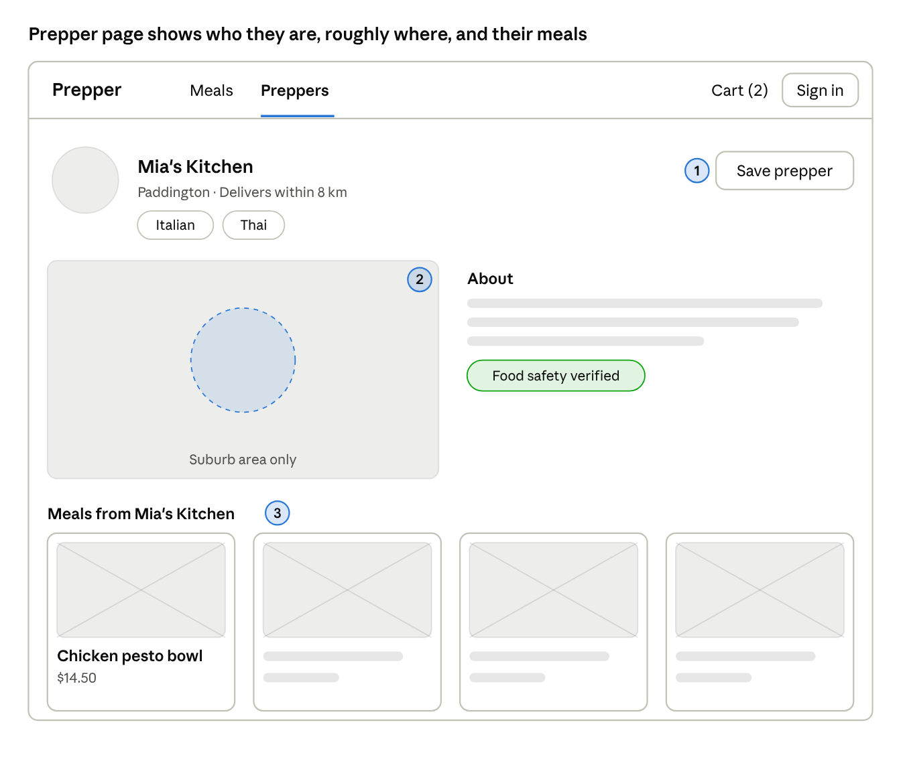

1. **Save prepper** adds them to favourites. Guests sign in first.
2. **Map** shows the suburb area only. Exact coordinates never reach the browser.
3. **Meals**: this prepper's active meals, using the same cards as W2.

- Delivery radius shows only when they deliver.
- An unknown or unverified prepper shows a 404 page.

## W5 Cart drawer

The drawer slides in from the right on any page. Only the bottom button changes once signed in (Phase 4).

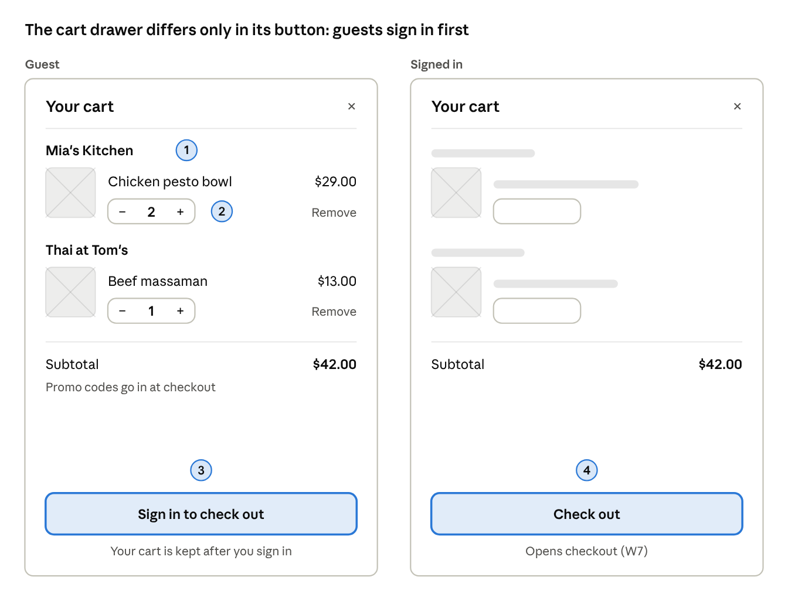

1. **Grouped by prepper**, because each prepper becomes their own invoice at checkout.
2. **Quantity** changes show at once and undo if the server says no (1 to 20 per meal). Remove takes the line out.
3. **Guest**: Sign in to check out opens Sign in (W6). The guest cart merges into the account cart after sign-in.
4. **Signed in**: Check out opens Checkout (W7) and locks the cart.

- The cart lives on the server; the browser only holds a cookie.
- A guest cart left alone for 1 hour is abandoned. Any change restarts the hour.
- Empty cart shows "Your cart is empty" and a link to Meals.

## W6 Sign in and buyer sign-up

There is no separate sign-up form: the first sign-in creates the buyer account (stages 1.1, 1.3, 1.5).

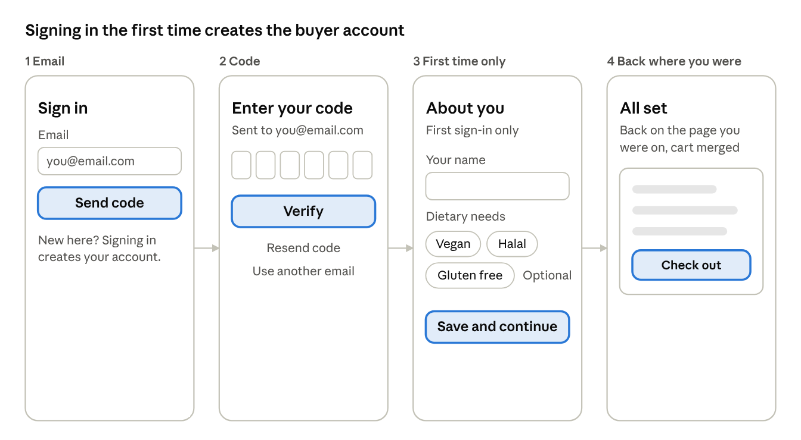

1. **Email or Google.** The same screen for buyers, preppers and admins.
2. **Code**: the code emailed by Supabase Auth. Resend and Use another email sit under the button.
3. **About you** (first sign-in only): name, plus optional dietary needs. Google fills in the name (plan change 4).
4. **Back where you were.** The guest cart is merged in. Coming from "Sign in to check out" lands on Checkout (W7).

- A deactivated account sees "This account has been deactivated" after the code step.
- Only an admin can reactivate it.
- Admins land on the Meals list (W14) instead.

## W7 Checkout

One page to review and pay, then a paid or failed screen (Phase 5).

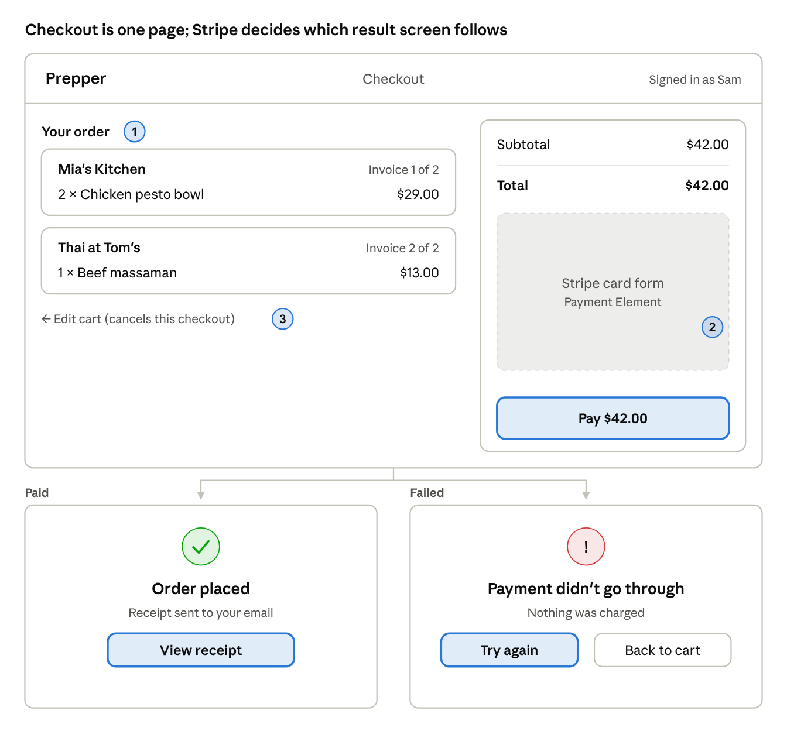

1. **Your order**, split into one box per prepper. Each box becomes that prepper's invoice. Prices come from the server, not the cart in the browser.
2. **Stripe Payment Element** holds the card fields. Pay starts the Stripe payment; the button shows a spinner and can't be pressed twice.
3. **Edit cart** goes back to the cart drawer and cancels this pending order, so the cart unlocks.

After Pay:

1. **Paid**: shown once Stripe's webhook confirms payment. View receipt opens Receipt detail (W9).
2. **Failed**: Try again keeps the same order. Back to cart cancels it and unlocks the cart.

## W8 Buyer profile

The buyer's own page, opened from the name in the header.

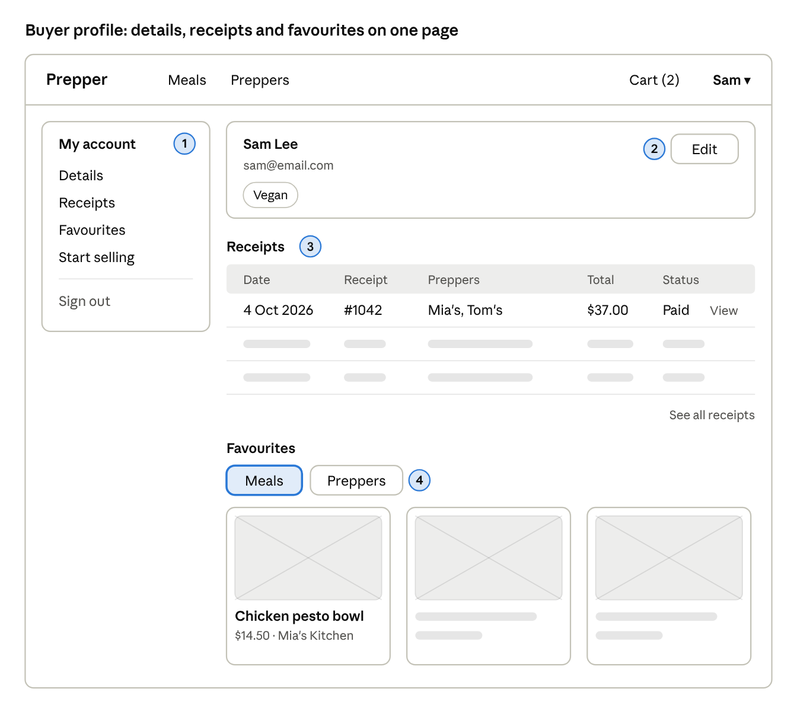

1. **Side menu** jumps to each part. Start selling opens Prepper sign-up (W10); a prepper sees "Selling" here instead, which opens W11.
2. **Details**: name, email, dietary needs, Edit.
3. **Receipts**, newest first, one row per order. View opens Receipt detail (W9). See all opens the full paged list.
4. **Favourites** with Meals and Preppers tabs. The heart on each card removes it.

## W9 Receipt detail

One order, shown the way it was paid: one block per prepper (stages 5.6 and 6.2).

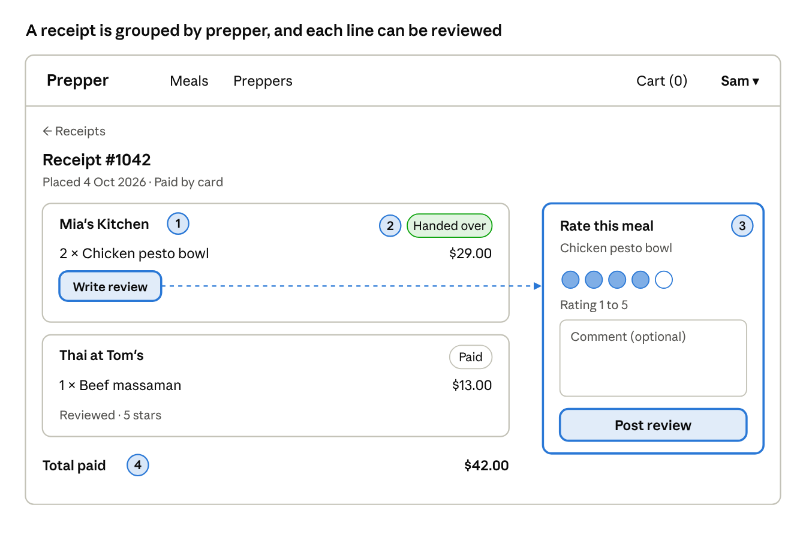

1. **One block per prepper invoice**, with each line's name and price as they were at checkout. Archived meals still show.
2. **Status per invoice**: Paid, then Handed over once the prepper confirms.
3. **Write review** opens this dialog: 1 to 5 stars and an optional comment. One review per line. Only shown when the invoice is paid or handed over; after posting, the button becomes "Reviewed".
4. **Totals** show what was paid.

## W10 Prepper sign-up

A signed-in buyer becomes a prepper through the sign-up form from stage 2.2, with the food safety step added in 2.9, then waits for an admin.

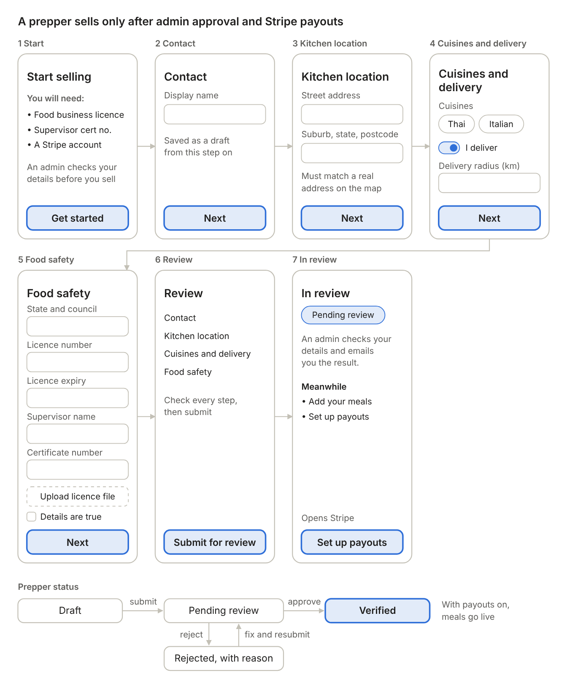

1. **Start selling** (from the buyer menu, W8) lists what they will need.
2. **Contact**: display name. Progress is saved as a draft from here on.
3. **Kitchen location**: address (must geocode; only the suburb is shown publicly).
4. **Cuisines and delivery**: at least one cuisine, and a delivery radius of 1 to 50 km if they deliver.
5. **Food safety** (added in 2.9): state and council, licence number and expiry (in the future), supervisor name and certificate number, the licence file (PDF, JPEG or PNG, up to 5 MB), and the tick-box.
6. **Review**: check every step, then submit. Submit moves them to pending review.
7. **In review**: they can add meals (hidden for now) and set up Stripe payouts while they wait.

**Status, step by step**

1. Starts as draft.
2. Submit moves it to pending review.
3. An admin approves (verified) or rejects with a reason. Both send an email.
4. A rejected prepper fixes the details and submits again.
5. Verified with payouts on puts their meals in browse.

## W11 Prepper profile

The prepper's home: what to hand over next and whether they've been paid (stages 5.2, 5.5, 5.7).

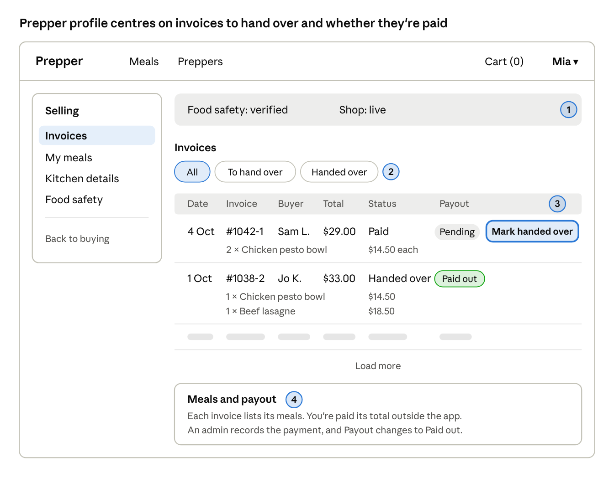

1. **Status banner**: food safety, payouts and whether the shop is live. If anything blocks selling, the banner says what to fix and links to it.
2. **Filters**: All, To hand over (paid, not yet handed over), Handed over. Newest first.
3. **Mark handed over** shows only on paid invoices, and asks to confirm. It completes the buyer's order once every prepper on it has handed over.
4. **Payouts**: Stripe account state and a link to Stripe. Payout per invoice shows Pending, Sent or Failed (retried).

Kitchen details and Food safety in the side menu reuse the W10 forms.

## W12 Prepper meals

Preppers add and look after their meals here (stages 2.4 to 2.7).

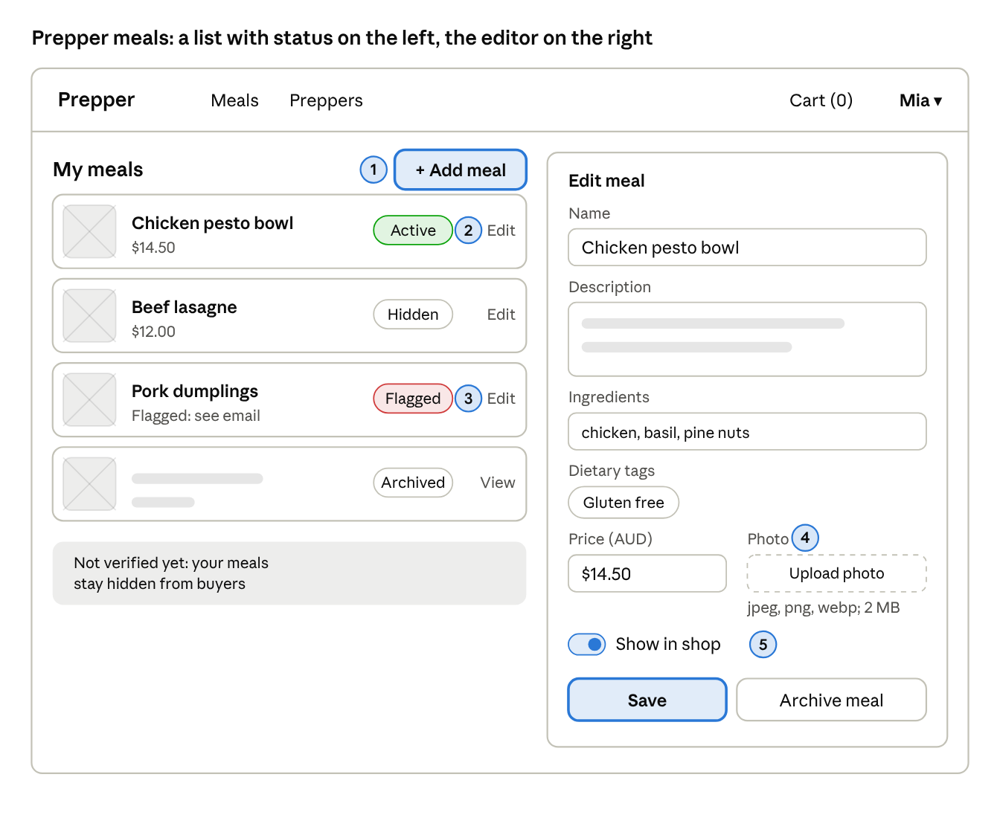

1. **Add meal** opens an empty editor on the right.
2. **Status** per meal: Active, Hidden, Flagged or Archived.
3. **Flagged** meals show that an admin flagged them; the reason is in the email. Show and Archive are turned off until an admin unflags it.
4. **Photo**: jpeg, png or webp, up to 2 MB.
5. **Show in shop** switches between active and hidden.

- Price is in whole cents, more than 0.
- Archive meal asks to confirm. Archived meals are never deleted and still show on old receipts.
- Until the prepper is verified, the grey note under the list explains why meals don't show in browse.

## W13 Admin details

Clicking any row in the admin lists (W14) opens its detail view, with the actions at the bottom. Admins land on the Meals list; there is no overview page.

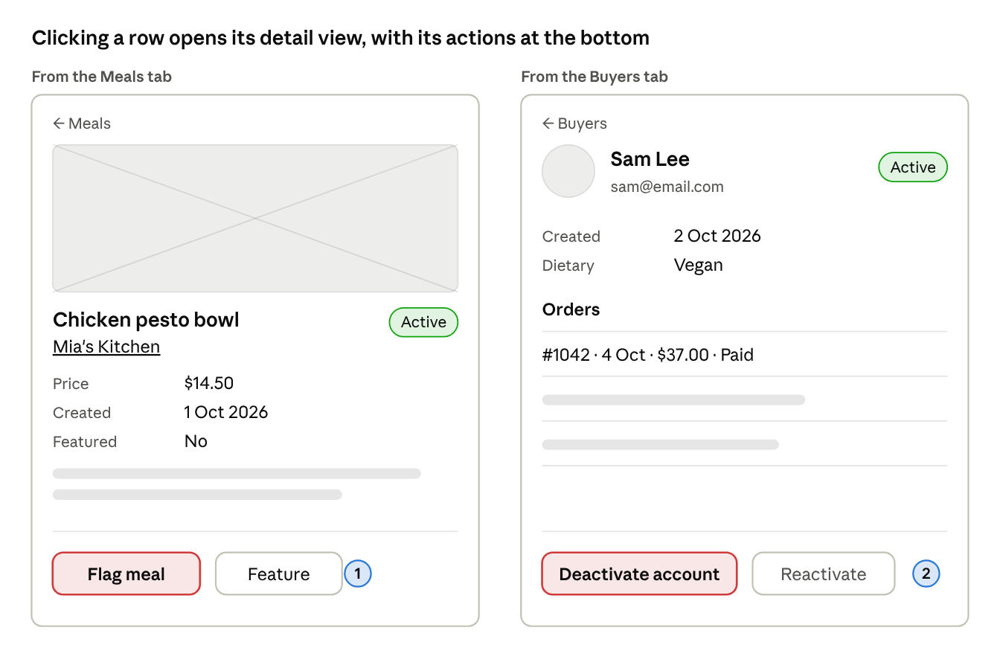

1. **Meal detail**: photo, prepper (opens Prepper detail, W15), price, status, created date and featured. Flag meal asks for a reason and becomes Unflag once flagged. Feature adds it to the home page.
2. **Buyer detail**: name, email, status, created date, dietary needs and their orders. Deactivate account asks for a reason and blocks sign-in. Reactivate undoes it.

Prepper detail is W15. Invite admin sits under the name menu (Alex ▾).

## W14 Admin lists

One tab each for meals, preppers and buyers, with the same pattern: filter at the top, click a row for its detail (stages 7.1, 7.2, 7.4).

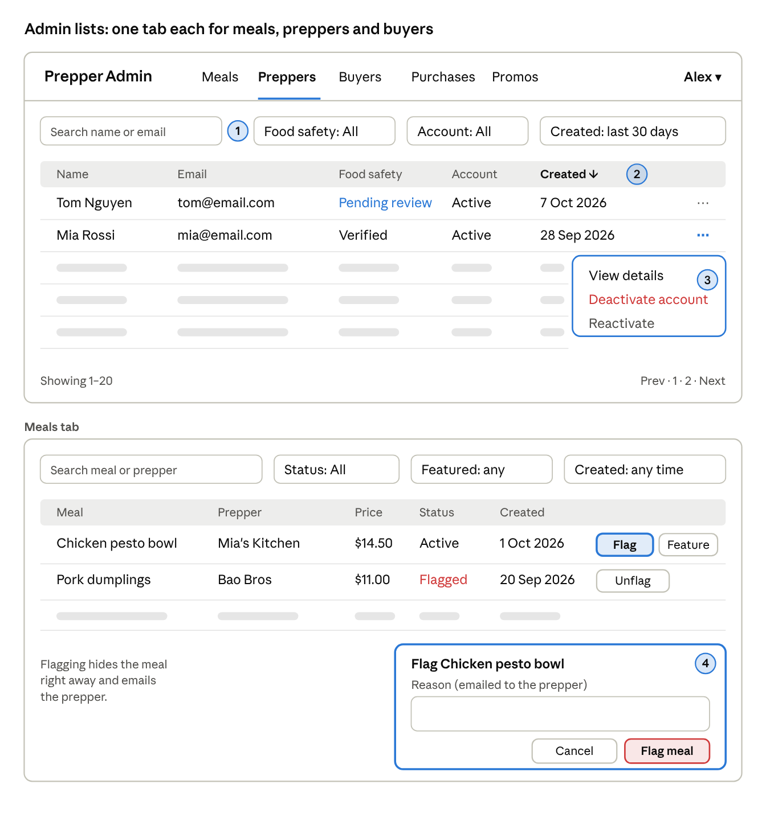

1. **Prepper filters** (shown): search, food safety status (pending review, verified, rejected, expired), account status and created date. Filtering, sorting and paging happen on the server and stay in the URL.
2. **Sort** by created date, newest first.
3. **Row menu**: view details, deactivate (with a reason) or reactivate. Clicking the row opens Prepper detail (W15).
4. **Flag** asks for a reason, hides the meal straight away and emails the prepper. Unflag makes it active again. Feature adds it to the home page (plan change 1).

- Buyers tab: the same table without the food safety column. Rows open Buyer detail (W13).
- Meals tab rows open Meal detail (W13).
- Every action is logged.

## W15 Prepper detail

Clicking a prepper in W14 opens this page. For a pending prepper it shows the licence and the Approve and Reject buttons (stage 7.5).

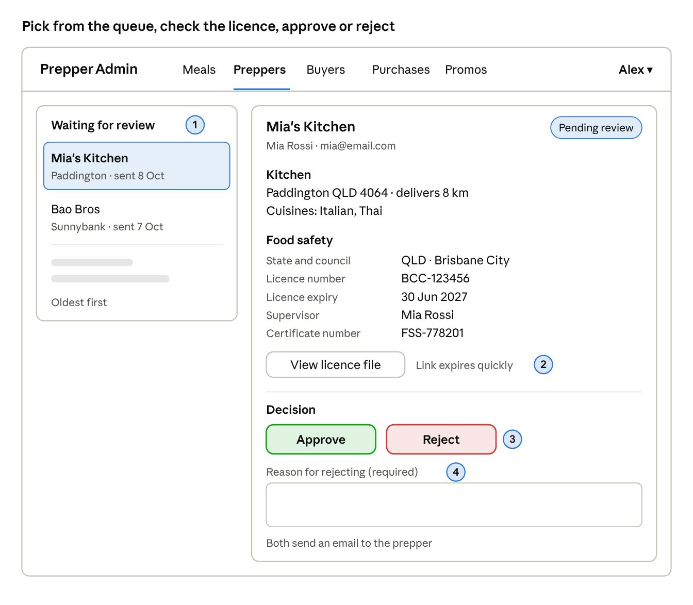

1. **Queue** (Waiting for review) lists pending preppers, oldest first, so you can work through them without going back to the list.
2. **View licence file** opens the private file through a short-lived signed link.
3. **Approve** makes the prepper verified. Their meals go live once payouts are on too.
4. **Reject** needs a reason. The prepper can fix the details and send it again.

- Both decisions are saved first, then emailed, and recorded as status events.
- A verified prepper shows Deactivate account and Reactivate in place of Approve and Reject.

## Plan changes for these screens

All nine are decided and now in the plan: stages 1.3, 3.5, 3.6, 7.1, 7.4 and 7.6, the Product entity, the class diagram and the business rules.

- [x] **1. Featured meals.** Add `featuredAt` to Product (empty = not featured). Admins set it with Feature / Unfeature in the Meals tab (stage 7.4). Home shows the 4 most recently featured. Until Phase 7, seed a few.
- [x] **2. Meals list API.** A new Phase 3 stage beside the prepper list (3.1): `GET /products` with search, dietary, cuisine, max price, distance, "delivers to me", sort and paging. Only active meals from verified preppers with payouts on.
- [x] **3. Home and Meals pages.** A new Phase 3 stage for W1 and W2, using the API above.
- [x] **4. About you step.** Add the first sign-in name and dietary step (W6 step 3) to stage 1.3.
- [x] **5. Admin "deactivate".** Decided: deactivate replaces suspend. Only admins deactivate and reactivate buyer and prepper accounts. Owners can't deactivate their own account. Admin accounts can't be deactivated or removed. 
- [x] **6. Admin details instead of an overview.** No overview page or activity feed. Add a Phase 7 stage for detail views (W13, W15): click any meal, prepper or buyer in the lists to see it and act on it.
- [x] **7. Admin Meals tab.** Stage 7.4 only flags and unflags. Add the meals table with search, status, featured and created filters.
- [x] **8. Role filter.** Add to stage 7.1: separate Preppers and Buyers tabs (a buyer has no prepper profile), and the status filter includes deactivated.
- [x] **9. Editing food safety after approval.** Decided: not needed. Editing licence details doesn't send a verified prepper back to review. No plan change.
