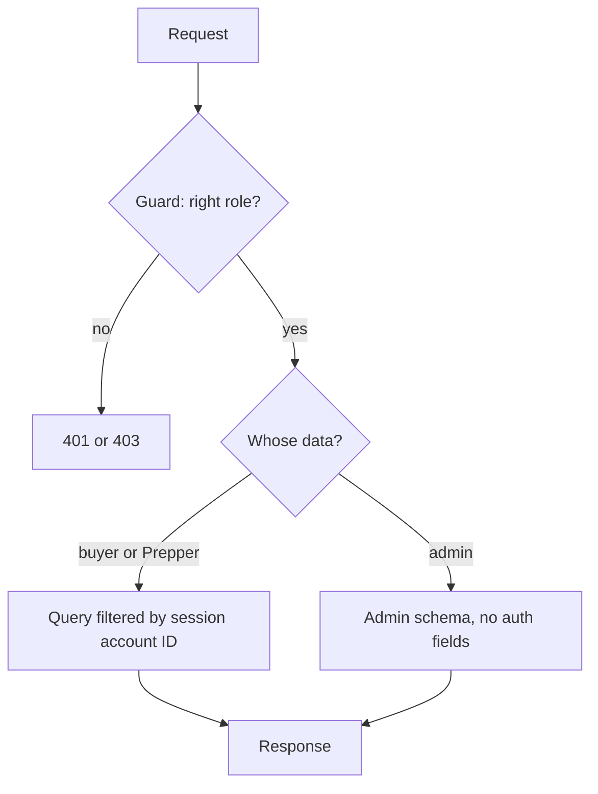
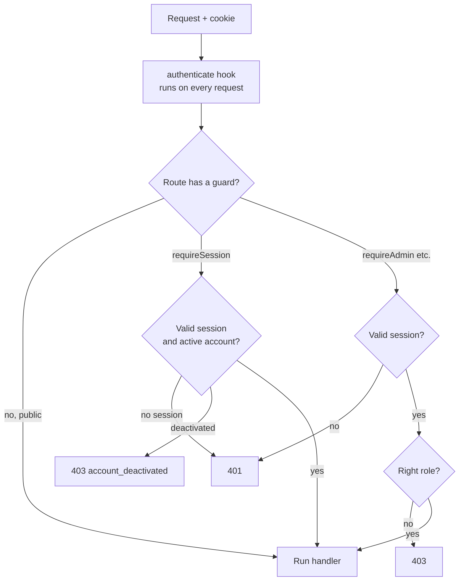
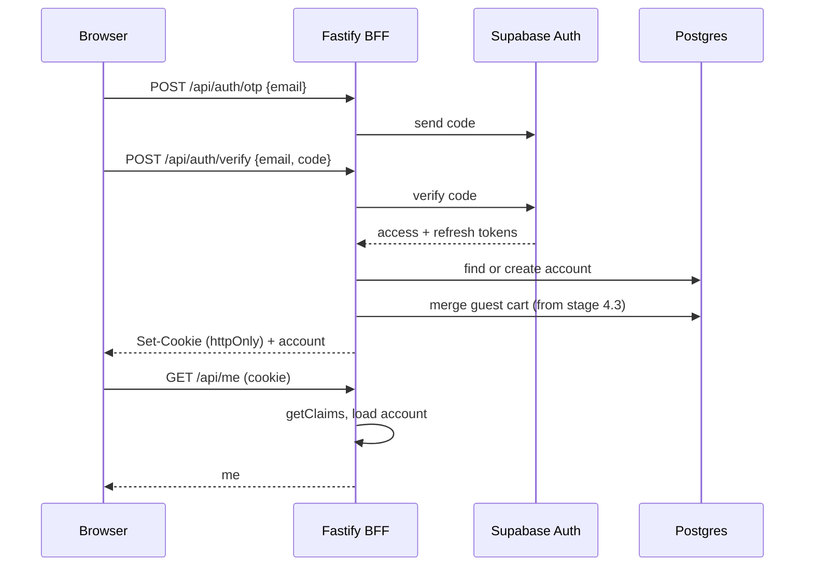

# Authentication

How sign-in state is kept, checked and used to protect routes. Decision record: [ADR 0013](../adr/0013-session-cookie-and-getclaims.md). Stages: 1.1 to 1.4. Sign-in is by email code (OTP) only; there is no Google or other single sign-on.

## The short version

1. The browser only talks to our Fastify server (the BFF). It never talks to Supabase.
2. After sign-in, the browser holds one httpOnly session cookie. JavaScript can't read it.
3. On every request, the server checks the cookie and works out who you are.
4. Each route then decides: open to anyone, needs a session, or needs a role.
5. The web app asks `GET /api/me` once and caches the answer. The router uses that answer to redirect. This is for a good experience only. The server is what keeps data safe.

## What the BFF is

BFF means "backend for frontend": a small server built for one frontend. Ours is Fastify.

1. **Holds secrets.** Supabase service key, Stripe keys, `JOBS_SECRET`. The browser only gets public keys.
2. **Owns the session.** The browser holds a cookie; the server holds the tokens.
3. **Enforces rules.** Anything checked only in React can be skipped with `curl`.
4. **Is the only database client.** Every query goes through Drizzle on the server.
5. **Is the contract.** Zod route schemas make `openapi.json`, which makes the web app's types.

Fastify calls its middleware "hooks". A hook is a function that runs before your route handler.

## Who can see what

Access levels:

- **Public** — anyone, signed in or not.
- **Guest only** — signed-out people; signed-in people are sent to their home page.
- **Signed in** — has a valid session. This only means "can open the page". What data it shows is covered in [Who can see which data](#who-can-see-which-data).
- **Buyer** — `accountType = buyer`.
- **Prepper** — a buyer with a Prepper profile, in any status (draft, pending review, verified, rejected). A rejected Prepper can fix their profile and resubmit but can't create or edit meals.
- **Verified Prepper** — a Prepper whose food safety check is approved.
- **Admin** — `accountType = admin`.

A Prepper is a buyer with a profile, so Preppers can use every buyer page too. Admins can browse the public pages read-only; the API refuses their cart, favourite, checkout and Prepper actions. See [Admin on public pages](#admin-on-public-pages).

### Web routes

| Route                                                                                | Screen                 | Access                              | Notes                                                                                        |
| ------------------------------------------------------------------------------------ | ---------------------- | ----------------------------------- | -------------------------------------------------------------------------------------------- |
| `/`                                                                                  | W1 Home                | Public                              |                                                                                              |
| `/meals`                                                                             | W2 Meals               | Public                              | Filters live in the URL.                                                                     |
| `/meals/$id`                                                                         | W3 Meal detail         | Public                              | An unavailable meal shows "Not available right now". Save needs sign-in (see action gates).  |
| `/preppers`                                                                          | W17 Preppers list      | Public                              | W17. Linked from the header.                          |
| `/preppers/$id`                                                                      | W4 Prepper page        | Public                              | Unknown or unverified shows 404.                                                             |
| Cart drawer (any page)                                                               | W5 Cart                | Public                              | Guest cart uses the guest-token cookie. Check out needs sign-in.                             |
| `/sign-in`                                                                           | W6 steps 1 and 2       | Guest only                          | Accepts `?redirect=`.                                                                        |
| `/welcome`                                                                           | W6 step 3, About you   | Signed in                           | Only on first sign-in.                                                                       |
| `/checkout`, `/checkout/paid`, `/checkout/failed`                                    | W7 Checkout            | Buyer                               | Admins refused.                                                                              |
| `/account`, `/account/receipts`, `/account/receipts/$id`, `/account/favourites`      | W8, W9 Buyer profile   | Buyer                               | The API checks the order belongs to you.                                                     |
| `/sell/sign-up`                                                                      | W10 Prepper sign-up    | Buyer without a verified profile    | Start, draft, resubmit after rejection.                                                      |
| `/sell`, `/sell/invoices`                                                            | W11 Prepper profile    | Prepper                             |                                                                                              |
| `/sell/meals`                                                                        | W12 Prepper meals      | Prepper                             | Draft and pending review can build meals (hidden until verified). Rejected is refused (403).                              |
| `/sell/kitchen`, `/sell/food-safety`                                                 | W10 forms reused       | Prepper                             |                                                                                              |
| `/admin/meals`, `/admin/preppers`, `/admin/buyers`                                   | W14 Admin lists        | Admin                               | Admins land on Meals.                                                                        |
| `/admin/meals/$id`, `/admin/buyers/$id`, `/admin/preppers/$id`                       | W13, W15 Details       | Admin                               |                                                                                              |
| `/admin/purchases`                                                                   | W16 Purchases          | Admin                               |                                                                                              |
| `*`                                                                                  | 404                    | Public                              |                                                                                              |
| `/forbidden`                                                                         | Not allowed            | Signed in                           | Signed in, wrong role.                                                                       |

### Admin on public pages

An admin can view meals, the meals list, the Preppers list and Prepper pages, and can change account and meal statuses in the admin area. An admin can't buy, sell, create meals, hold a cart or save favourites.

| Control | Guest | Buyer or Prepper | Admin |
| --- | --- | --- | --- |
| Cart icon and drawer | Shown | Shown | Hidden |
| Add to cart (Meals, Meal detail) | Shown | Shown | Hidden |
| Favourite heart | Shown; click asks to sign in | Shown | Hidden |
| Header links | Meals, Preppers | Meals, Preppers | Meals, Preppers, Admin (to `/admin/meals`) |
| Account menu | Sign in | Account, Start selling or Sell, Sign out | Name, Invite admin, Sign out |
| `/account`, `/checkout`, `/sell/*` | Sign in first | Allowed by role | `/forbidden` |

1. Controls are hidden, not disabled. The web app reads the role from `/me`.
2. Hiding is only for a good experience. The API still refuses every buyer and Prepper route for admins.
3. An admin has no cart. Signing in as an admin does not merge a guest cart; it is left to expire after its hour, and the response does not say "cart merged".

### Action gates (not routes)

These live on public pages. The page loads for everyone; the action needs a session.

1. Save a meal or Prepper as a favourite: guests are sent to Sign in, then back.
2. Check out from the cart drawer: guests are sent to Sign in, then to Checkout.
3. Start selling: a link in the buyer menu, so only signed-in buyers see it.

### API routes

| Route                                      | Guard                                                                                 |
| ------------------------------------------ | ------------------------------------------------------------------------------------- |
| `GET /api/meals`, `GET /api/preppers`   | None (public). May still use the account if there is one.                             |
| `/api/auth/*` (send code, verify, logout)  | None; they create or end the session.                                                 |
| `GET /api/me`                              | `requireSession`. A missing session answers 401, which the web app treats as signed out. |
| `/api/cart/*`                              | Session or guest-token cookie; admins refused.                                        |
| `/api/checkout/*`, `/api/orders/*`         | `requireBuyer`                                                                        |
| `/api/sell/*`                              | `requirePrepper` (profile creation uses `requireBuyer`)                               |
| `/api/admin/*`                             | `requireAdmin`, applied once to the whole prefix                                      |
| `POST /api/webhooks/stripe`                | Stripe signature on the raw body. No session.                                         |
| `/api/jobs/*`                              | `JOBS_SECRET` header. No session.                                                     |

## Who can see which data

Two checks happen, and they are separate:

1. **Route access:** may this role call this endpoint? (guards)
2. **Data access:** is this record theirs? (the query)

| Who               | Can see                                                                                                   | Can change                                                  |
| ----------------- | --------------------------------------------------------------------------------------------------------- | ----------------------------------------------------------- |
| Guest             | Public meals and Prepper pages (public fields only), their own guest cart                                 | Their guest cart                                            |
| Buyer             | Their own account, orders, receipts, favourites and reviews                                               | Their own account details, cart and reviews                 |
| Prepper           | Everything a buyer sees, plus their own profile, meals and invoices, and whether they've been paid out                              | Their own profile and meals; hand over their own invoices   |
| Admin             | Every buyer and Prepper account: name, email, type, status, dietary needs, orders, Prepper details        | Deactivate or reactivate buyers and Preppers; flag meals; approve or reject Preppers |

Rules:

1. **Own data only.** For buyers and Preppers, the account ID comes from the session. No endpoint takes another person's account ID.
2. **Scope in the query.** Filter by the session's account ID in the database query, so a record that isn't yours can't be returned.
3. **Someone else's record** answers 404, the same as a record that doesn't exist, so nobody can tell whether an ID exists. 403 is only for "your role can't call this route".
4. **No authentication details, ever.** Tokens and sessions live in Supabase Auth. They are never loaded into an API response, for admins or anyone else.
5. **Separate admin response schemas.** Admin routes return their own zod schemas, so a field can't leak by accident.
6. **Deactivate rules.** Admins only, with a reason, recorded in `AuditLog`. Not on admin accounts and not on themselves (see [business rules](04-business-rules.md)).
7. **Public fields only** on public pages: suburb not exact coordinates, no email, no licence.



```ts
// scoped to the session account: another person's order can't match
where(and(eq(orders.id, orderId), eq(orders.accountId, request.account.id)))
```

## How the server checks a request



Step by step:

1. **`authenticate` hook** runs on every request, public ones too. It never rejects.
   1. Read the session cookie.
   2. Check the access token with Supabase's `getClaims()`. This checks the signature locally against Supabase's public keys, with no call per request.
   3. If the token has expired, use the refresh token to get a new one and set new cookies.
   4. Look up the account row by the token's email (lowercase), then read its type, status and Prepper profile from Postgres.
   5. Set `request.account` to the account, or `null`.
2. **Guards** are `preHandler` functions added to a route. Each one reads `request.account` and rejects or lets the request through.
3. **The handler** runs. Ownership IDs come from `request.account`, never from the body or URL.

Guards:

| Guard                   | Rejects with | When                                                                  |
| ----------------------- | ------------ | --------------------------------------------------------------------- |
| `requireSession`        | 401          | No valid session.                                                     |
| (any guard)             | 403          | Account is deactivated (`account_deactivated`).                       |
| `requireBuyer`          | 403          | Not a `buyer` (this refuses admins).                                  |
| `requirePrepper`        | 403          | No Prepper profile.                                                   |
| `requireMealEditor`     | 403          | Prepper's profile is `rejected` (draft, pending review and verified pass). Used on routes that create or edit meals. |
| `requireAdmin`          | 403          | Not an `admin`.                                                       |

Rules:

1. **401** means "I don't know who you are". The web app sends you to sign in.
2. **403** means "I know who you are, and you can't do this". The web app shows a not-allowed state. Signing in again wouldn't help.
3. All admin routes sit under `/api/admin`, so one `requireAdmin` covers them and a forgotten guard can't expose one.
4. A public route may still behave differently for a signed-in user (for example, marking a meal as a favourite).
5. The own-meal rule (a Prepper can't buy their own meals) is not a guard. The cart, merge and checkout handlers compare the meal's Prepper with the session's Prepper profile and return `422` `own_meal`.
6. Meal create and edit routes use `requireMealEditor`: pending Preppers can build meals (wireframe W10), rejected Preppers can't. Profile and food safety routes need only `requirePrepper`, so a rejected Prepper can fix and resubmit. Only buyer-facing pages (browse, cart, checkout) depend on a Prepper being verified.

## How Supabase gets called

| Moment                          | Call                                              | How often                                |
| ------------------------------- | ------------------------------------------------- | ---------------------------------------- |
| Browser rendering or navigating | None                                              | Never                                    |
| Browser asks "am I signed in?"  | `GET /api/me` to our own API                      | Once, then cached                        |
| Every API request               | `getClaims()`, checked locally                    | No network call                          |
| Fetching Supabase's public keys | One HTTP call                                     | Once per function instance, then cached  |
| Access token expired            | Refresh with the refresh token                    | About once an hour per signed-in person  |
| Sign-in                         | Send the code, then verify the code               | Once per sign-in                         |
| Sign-out                        | Revoke the session                                | Once                                     |

Why not `getUser()` on every request:

1. It always makes a network call to Supabase Auth, so each API call would pay a round trip.
2. One page load fires several API calls, so it would be called several times per page.
3. Public pages would depend on Supabase Auth being up.

Things to know:

1. `getClaims()` only skips the network when the Supabase project uses **asymmetric JWT signing keys**. With the old shared secret it quietly calls the Auth server, like `getUser()`. Check this in the Supabase dashboard during stage 1.2.
2. An access token stays valid until it expires (default 1 hour) even after sign-out. The cookie is cleared, and the account lookup on every request blocks deactivated accounts straight away, so this is acceptable.
3. The public keys are not user state, so caching them in the function's memory doesn't break the "no in-memory state" rule in `api/CLAUDE.md`.

## Cookie rules

1. Supabase tokens are stored in chunked httpOnly cookies, using Supabase's server-side pattern ([`@supabase/ssr`](https://supabase.com/docs/guides/auth/server-side)). Chunked means a large value is split across several cookies.
2. `HttpOnly`, `Secure`, `SameSite=Lax`, `Path=/`.
3. The web and api projects share one domain on Vercel, so the cookie is first-party.
4. State-changing routes check the `Origin` header (stage 1.2). This blocks cross-site form posts.
5. Tokens are never sent in a response body, never logged, and never stored by the web app.

## How the web app protects routes

The web app uses TanStack Router layout routes. Each layout holds one guard, and pages go inside the layout they need.

```text
__root.tsx     context: { queryClient }
_public/       no guard
_guest/        signed in → redirect to role home
_auth/         signed out → redirect to /sign-in?redirect=<this page>
  _buyer/      accountType is buyer
  _prepper/    buyer with a Prepper profile (added in stage 2.1)
  _admin/      accountType is admin
```

Steps:

1. Each guard's `beforeLoad` calls `queryClient.ensureQueryData(meQuery)`. The first call fetches `/api/me`; later calls use the cache.
2. `/api/me` answers `{ id, name, accountType, prepperProfile: { status } | null }`. A 401 means signed out and is not an error page.
3. A failed check does `throw redirect({ to, search })`.
4. After sign-in or sign-out, invalidate the `me` query, then call `router.invalidate()`.
5. The one API client handles 401 for every call: clear `me` and go to sign in with `redirect`. A 403 shows the not-allowed state.
6. While `/me` loads, protected layouts show a spinner. They never render the page first and redirect later.
7. A redirect target is accepted only if it starts with `/` and not `//`. Anything else goes to the role's home. This stops open redirects.
8. For an admin, a redirect target is also accepted only if it is a public page or starts with `/admin`. Buyer and Prepper pages (`/account`, `/checkout`, `/sell`) go to `/admin/meals` instead of `/forbidden`.

Why not a global React context for auth:

1. `/me` is server data. `web/CLAUDE.md` keeps server data in TanStack Query only, so there is one cache and not two.
2. Router context is used only to hand `queryClient` to `beforeLoad`.
3. TanStack Query is not "the" auth check. It caches the server's answer. The server still checks every request.

Official reading: [TanStack Router authenticated routes](https://tanstack.com/router/latest/docs/framework/react/guide/authenticated-routes), [Supabase `getClaims`](https://supabase.com/docs/reference/javascript/auth-getclaims), [Supabase JWT signing keys](https://supabase.com/docs/guides/auth/signing-keys).

## Sign-in flow



1. The browser sends the email, then the code. It never sees a token.
2. The server finds the account by email, or creates an `active` buyer on first sign-in.
3. A deactivated account is refused with 403 after the code step.
4. The server sets the cookie. The web app then fetches `/api/me` and redirects.
5. From stage 4.3 the verify route also merges the guest cart into the account cart, in the same request. The browser makes no separate merge call.
6. Email is the only link between Supabase Auth and our account. It can't change in v1, and `name+tag@gmail.com` is a different email from `name@gmail.com`.

## Sign-in limits

Built in stage 1.2. They stop someone filling an inbox with codes or guessing a code.

1. Limits are counted in the database, because the server keeps nothing in memory between requests.
2. Starting values: 5 code requests per email and 20 per IP in 15 minutes; 5 wrong codes, then a 15-minute wait. The 1.2 feature doc sets the final numbers.
3. Over the limit answers `429` with a plain "too many tries, wait a few minutes" message. It never says whether the email has an account.
4. Supabase's own limits still apply underneath.

## Tests to expect

1. API: for every guarded route, `app.inject()` for no session (401), wrong role (403), deactivated (403) and allowed.
1a. API: for every route that returns a record, a test that a second buyer or Prepper can't read or change it (404), and that admin responses contain no auth fields.
2. API session cases: valid, refreshed, revoked, missing, deactivated; sign-in limits return 429 and reset.
3. Web: each layout redirects when signed out and when the role is wrong; redirect target is kept; unsafe `redirect` values are ignored; an admin's redirect to a buyer page goes to `/admin/meals`.
4. End to end: `sign-in-out.feature` shows sign in, the account name, sign out, and the redirect away from an account page.

